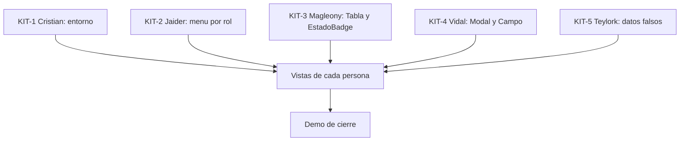

# Daily 2 - Frontend de las 20 vistas de sistemasar.net

Fecha: 2026-10-14
Estado: propuesta para confirmar en los primeros 15 minutos del daily

---

## 0. Instrucciones para el agente de IA (leer primero)

Eres el asistente de UNA persona del equipo. Esa persona te dirá su nombre. Reglas:

1. Lee las secciones 1 a 5 completas antes de escribir código.
2. Ejecuta SOLO las tareas de esa persona (sección 6). No hagas tareas ni vistas de otros.
3. Edita SOLO los archivos de tus tareas. Si necesitas un cambio en una pieza compartida (sección 4), pídeselo a su responsable y no la modifiques.
4. Este daily es SOLO frontend con datos falsos. No llames al backend ni a la base de datos. No uses `fetch` en ninguna vista.
5. Toda vista obtiene sus datos a través de una función de `src/services/` (sección 5). Nunca importes `datosFalsos.js` directamente dentro de una vista.
6. Los campos de los datos falsos deben coincidir con las columnas de las tablas del script DDL en `database/`. Si no estás seguro de un nombre de campo, léelo del script o pregunta. No inventes campos.
7. Sigue el estándar visual de los mockups (sección 3). Las imágenes de los mockups están en `Mockups.docx`; si la persona las guarda en `docs/mockups/`, úsalas como referencia visual.
8. Trabaja en una rama por vista y entrega con un pull request a `develop`. No hagas commit directo a `main` ni a `develop`.
9. Al terminar cada vista, verifica sus criterios de aceptación (sección 7) y dile a la persona qué probaste y qué falta.
10. No empieces ninguna vista hasta que el pull request de KIT-1 (el entorno de Cristian) esté unido a `develop`. Mientras tanto, trabaja solo en la pieza compartida de tu persona (KIT-2 a KIT-5).

---

## 1. Objetivo del día

Construir en React las 20 vistas de los mockups, con datos falsos, repartidas entre los 5 integrantes. Al final del día cada vista abre en su ruta, se ve como el mockup y se puede recorrer el flujo de cada rol. No hay conexión con el backend todavía.

Entregables:

- Las piezas compartidas de la sección 4, subidas a `develop` primero.
- Las 20 vistas de la sección 3, cada una en su archivo y en su ruta.
- Una capa de servicios con datos falsos, lista para cambiarse por llamadas reales al backend sin tocar las vistas.

---

## 2. Contexto del proyecto

### Stack

- Frontend: React con Vite y `react-router-dom`.
- Backend y base de datos: ya existen de los dailys anteriores, pero NO se usan en este daily.

### Estado del repositorio al empezar

```text
frontend/src/
├── components/
│   ├── Layout.jsx      # encabezado con logo y avatar, menú lateral fijo
│   └── Boton.jsx       # botón rectangular reutilizable
├── pages/
│   └── Estado.jsx      # página de prueba del primer daily
├── services/
│   └── api.js          # exporta API_URL
└── App.jsx
```

No existe todavía ninguna sesión, ni login real, ni rutas protegidas. En este daily el menú del `Layout` se decide por la primera parte de la ruta (`/cliente`, `/tecnico` o `/admin`), sin necesitar sesión.

### Equipo

| Persona | ID |
| --- | --- |
| Teylork (líder) | `T` |
| Magleony | `M` |
| Cristian | `C` |
| Vidal | `V` |
| Jaider | `J` |

### Convenciones

- Ramas: `feature/front-<vista>`, por ejemplo `feature/front-mis-tickets`.
- Commits cortos y en español que dicen qué se hizo.
- Cada pull request lo revisa al menos un compañero antes de unirse a `develop`.
- Componentes en `src/components/`, páginas en `src/pages/<rol>/`, servicios en `src/services/`, datos falsos en `src/data/`.

---

## 3. Las 20 vistas: reparto, rutas y archivos

Estándar visual de los mockups: menú lateral fijo, encabezado con logo y avatar, y botones rectangulares. Toda vista se renderiza dentro de `Layout`, salvo las de autenticación (1, 2 y 3). Los archivos de las 20 vistas ya existen vacíos gracias a KIT-1, así que cada responsable solo reemplaza el contenido de los suyos.

| # | Vista | Responsable | Ruta | Archivo | Qué debe mostrar |
| --- | --- | --- | --- | --- | --- |
| 1 | Login | Vidal | `/login` | `pages/auth/Login.jsx` | Correo, contraseña y botón; mensaje de error; al entrar va al dashboard del rol |
| 2 | Recuperación de contraseña | Vidal | `/recuperar` | `pages/auth/RecuperarContrasena.jsx` | Campo de correo y botón de envío; mensaje de confirmación |
| 3 | Registro de nuevo cliente | Vidal | `/registro` | `pages/auth/Registro.jsx` | Formulario de registro de cliente con validación de campos obligatorios |
| 4 | Dashboard del cliente | Vidal | `/cliente` | `pages/cliente/DashboardCliente.jsx` | Resumen de sus tickets y los estados |
| 5 | Crear ticket | Jaider | `/cliente/tickets/nuevo` | `pages/cliente/CrearTicket.jsx` | Formulario con selección de UNA O VARIAS categorías o servicios a la vez |
| 6 | Mis tickets | Jaider | `/cliente/tickets` | `pages/cliente/MisTickets.jsx` | Listado de tickets con filtro por estado |
| 7 | Detalle del ticket | Jaider | `/cliente/tickets/:id` | `pages/cliente/DetalleTicketCliente.jsx` | Datos del ticket e historial de cambios de estado |
| 8 | Calificar ticket | Jaider | `/cliente/tickets/:id/calificar` | `pages/cliente/CalificarTicket.jsx` | Puntuación de 1 a 5 estrellas; la calificación es OPCIONAL, debe haber una opción clara de omitir |
| 9 | Perfil del cliente | Vidal | `/cliente/perfil` | `pages/cliente/PerfilCliente.jsx` | Datos del cliente y sus equipos registrados |
| 10 | Dashboard del técnico | Cristian | `/tecnico` | `pages/tecnico/DashboardTecnico.jsx` | Tickets asignados al técnico (un ticket solo tiene un técnico) |
| 11 | Detalle de ticket asignado | Cristian | `/tecnico/tickets/:id` | `pages/tecnico/DetalleTicketTecnico.jsx` | Datos del ticket y opción de cambiar el estado |
| 12 | Actualizar avance | Cristian | `/tecnico/tickets/:id/avance` | `pages/tecnico/ActualizarAvance.jsx` | Formulario para registrar el avance en el historial del ticket |
| 13 | Consulta de inventario | Cristian | `/tecnico/inventario` | `pages/tecnico/InventarioTecnico.jsx` | Repuestos y componentes disponibles, solo lectura |
| 14 | Dashboard del administrador | Teylork | `/admin` | `pages/admin/DashboardAdmin.jsx` | Métricas: tickets abiertos y cerrados, técnicos activos |
| 15 | Gestión de usuarios | Magleony | `/admin/usuarios` | `pages/admin/GestionUsuarios.jsx` | Listado y formulario para crear y editar Cliente, Técnico y Administrador |
| 16 | Asignación de técnico | Teylork | `/admin/tickets/:id/asignar` | `pages/admin/AsignarTecnico.jsx` | Selección de un técnico para el ticket |
| 17 | Gestión de categorías | Teylork | `/admin/categorias` | `pages/admin/GestionCategorias.jsx` | Listado y formulario de categorías o servicios |
| 18 | Gestión de inventario | Magleony | `/admin/inventario` | `pages/admin/GestionInventario.jsx` | Agregar, editar y dar de baja repuestos o equipos |
| 19 | Reportes | Magleony | `/admin/reportes` | `pages/admin/Reportes.jsx` | Reportes por técnico, por categoría y por periodo |
| 20 | Calificaciones recibidas | Teylork | `/admin/calificaciones` | `pages/admin/CalificacionesRecibidas.jsx` | Calificaciones recibidas, para supervisar el desempeño de los técnicos |

### Resumen por persona

| Persona | Vistas |
| --- | --- |
| Vidal | 1, 2, 3, 4, 9 |
| Jaider | 5, 6, 7, 8 |
| Cristian | 10, 11, 12, 13 |
| Teylork | 14, 16, 17, 20 |
| Magleony | 15, 18, 19 |

Los paneles `PanelCliente`, `PanelTecnico` y `PanelAdmin` que pudieran existir como ejemplo se reemplazan por los dashboards 4, 10 y 14.

---

## 4. Piezas compartidas (se suben primero)

Estas piezas evitan conflictos en Git y componentes repetidos. Cada una tiene UN responsable. El resto las usa sin modificarlas.

| ID | Pieza | Responsable | Qué es |
| --- | --- | --- | --- |
| KIT-1 | Entorno: rutas, páginas vacías y carpetas | Cristian | `App.jsx` con las 20 rutas de la sección 3, un archivo de página vacío por vista, los archivos de servicios vacíos, las carpetas, `src/routes/rutaPorRol.js` y una página índice con enlaces a todas las vistas |
| KIT-2 | Menú por rol | Jaider | El menú lateral de `Layout` muestra los enlaces del rol según la primera parte de la ruta |
| KIT-3 | Tabla y etiqueta de estado | Magleony | `src/components/Tabla.jsx` y `src/components/EstadoBadge.jsx` |
| KIT-4 | Modal y campos de formulario | Vidal | `src/components/Modal.jsx` y `src/components/Campo.jsx` (etiqueta, input y mensaje de error) |
| KIT-5 | Datos falsos compartidos | Teylork | `src/data/datosFalsos.js` con tickets, usuarios, categorías, inventario y calificaciones |

### Detalle de KIT-1 (entorno, responsable: Cristian)

Es lo primero del día. Cristian deja el entorno listo para que los otros cuatro empiecen sus vistas sin crear carpetas ni tocar `App.jsx`.

1. Hacer `git pull`, cambiar a `develop` y crear la rama `feature/front-entorno`.
2. Confirmar que `react-router-dom` está instalado con `npm list react-router-dom` dentro de `frontend/`. Si no está, instalarlo con `npm install react-router-dom`.
3. Crear las carpetas `src/pages/auth/`, `src/pages/cliente/`, `src/pages/tecnico/`, `src/pages/admin/`, `src/routes/` y `src/data/`. Git no sube carpetas vacías, así que poner un archivo `.gitkeep` en `src/data/`.
4. Crear `src/routes/rutaPorRol.js`:

```javascript
export const rutaPorRol = {
  cliente: "/cliente",
  tecnico: "/tecnico",
  administrador: "/admin",
};
```

5. Crear los 20 archivos de página con los nombres y carpetas de la sección 3. Las vistas 4 a 20 van dentro de `Layout` y las vistas 1, 2 y 3 no. Si el `Layout` actual no recibe `children`, ajustarlo y avisar a Jaider, que es su responsable. Ejemplo de una vista con `Layout`:

```javascript
import Layout from "../../components/Layout";

export default function MisTickets() {
  return (
    <Layout>
      <h1>Mis tickets</h1>
    </Layout>
  );
}
```

Ejemplo de una vista sin `Layout`:

```javascript
export default function Login() {
  return <h1>Login</h1>;
}
```

6. Crear estos 8 archivos vacíos en `src/services/`, cada uno con solo el comentario `// Funciones con datos falsos de este módulo`: `authService.js`, `clienteService.js`, `ticketsService.js`, `tecnicoService.js`, `adminService.js`, `usuariosService.js`, `inventarioService.js` y `reportesService.js`.
7. Crear `src/pages/Indice.jsx`, una página temporal con enlaces a las 20 vistas, para recorrerlas sin sesión. Lleva una lista con número, nombre y ruta de cada vista de la sección 3. En las rutas con `:id` se usa `1` en el enlace, por ejemplo `/cliente/tickets/1`:

```javascript
import { Link } from "react-router-dom";

const vistas = [
  { numero: 1, nombre: "Login", ruta: "/login" },
  { numero: 7, nombre: "Detalle del ticket", ruta: "/cliente/tickets/1" },
  // ...completar con las 20 vistas de la sección 3
];

export default function Indice() {
  return (
    <ul>
      {vistas.map((vista) => (
        <li key={vista.numero}>
          <Link to={vista.ruta}>
            {vista.numero}. {vista.nombre}
          </Link>
        </li>
      ))}
    </ul>
  );
}
```

8. Escribir las rutas en `App.jsx`, dentro del router que ya existe: la ruta `/` para `Indice`, `/estado` para la página `Estado` del primer daily, y una `Route` por cada una de las 20 vistas con la ruta de la sección 3:

```javascript
<Routes>
  <Route path="/" element={<Indice />} />
  <Route path="/estado" element={<Estado />} />
  <Route path="/login" element={<Login />} />
  {/* ...una Route por cada vista de la sección 3... */}
  <Route path="/admin/calificaciones" element={<CalificacionesRecibidas />} />
</Routes>
```

9. Probar con `npm run dev`: abrir el índice y entrar a las 20 rutas. Cada una debe mostrar el nombre de su vista, sin errores en la consola del navegador (tecla F12). Las rutas con `:id` solo muestran el nombre por ahora.
10. Subir la rama, abrir el pull request a `develop`, pedir la revisión de Teylork y avisar al grupo cuando se una, porque nadie empieza sus vistas antes.

### Detalle de KIT-2

El `Layout` lee la primera parte de la ruta con `useLocation()` y decide el menú:

- `/cliente`: Dashboard, Crear ticket, Mis tickets, Perfil.
- `/tecnico`: Dashboard, Inventario.
- `/admin`: Dashboard, Usuarios, Categorías, Inventario, Reportes, Calificaciones.

### Detalle de KIT-5

Reglas de `datosFalsos.js`:

- Los nombres de los campos salen de las columnas del script DDL en `database/` (AJUSTAR: léelos del script, no los inventes).
- Los estados de los tickets son los definidos en el modelo del proyecto.
- Incluye varios tickets en distintos estados, varios técnicos, clientes con equipos, categorías, repuestos de inventario y calificaciones con puntuación de 1 a 5.
- Incluye tres usuarios falsos para el login falso: `cliente@prueba.com`, `tecnico@prueba.com` y `admin@prueba.com`, con la contraseña falsa `Prueba123*`. Esta contraseña es solo para el frontend falso.

### Orden del día

| Fase | Quién | Qué | Depende de |
| --- | --- | --- | --- |
| 0 | Cristian | KIT-1: el entorno | nada |
| 1 | Jaider (KIT-2), Magleony (KIT-3), Vidal (KIT-4), Teylork (KIT-5) | Piezas compartidas, en paralelo con la fase 0; cada una toca solo sus archivos | nada |
| 2 | Todos | Las vistas de la sección 6, en el orden de cada lista | KIT-1 unido a `develop`; las piezas compartidas, si ya están |
| 3 | Todos | Demo de cierre | las vistas |



---

## 5. Capa de servicios con datos falsos

Ninguna vista usa los datos directamente. Cada módulo tiene un archivo en `src/services/` con funciones que HOY devuelven datos falsos y MAÑANA harán `fetch` al backend. Así, al conectar, solo se cambia el cuerpo de la función y las vistas no se tocan.

Ejemplo (`src/services/ticketsService.js`):

```javascript
import { tickets } from "../data/datosFalsos";

export async function listarTickets() {
  return tickets;
}

export async function obtenerTicket(id) {
  return tickets.find((t) => String(t.id) === String(id)) || null;
}
```

Reglas:

- Las funciones son `async` y devuelven lo mismo que devolvería el backend (listas y objetos con los campos de las tablas).
- Las acciones de crear, editar o borrar actualizan el estado local de la vista y muestran un mensaje de éxito. No se guardan de forma permanente.
- Cristian crea los archivos vacíos en KIT-1, y cada persona llena los de su módulo sin editar los de otros:
  - Vidal: `authService.js` y `clienteService.js`.
  - Jaider: `ticketsService.js`.
  - Cristian: `tecnicoService.js`.
  - Teylork: `adminService.js` (dashboard, asignación, categorías y calificaciones).
  - Magleony: `usuariosService.js`, `inventarioService.js` y `reportesService.js`.
- Login falso (`authService.js` de Vidal): `iniciarSesion(correo, contrasena)` busca el correo y la contraseña en los usuarios falsos de KIT-5 y devuelve `{ rol, nombre }`, o lanza un error con el texto "Correo o contraseña incorrectos".

---

## 6. Tareas por persona

El orden de cada lista va de lo más simple a lo más pesado, para tener algo que mostrar desde el primer momento. Las vistas no se empiezan hasta que el pull request de KIT-1 esté en `develop`; mientras tanto, cada uno hace su pieza compartida. Si una pieza compartida aún no está en `develop`, empieza la vista con HTML simple y cámbialo cuando llegue.

### Vidal (V)

1. KIT-4: `Modal.jsx` y `Campo.jsx`. Súbelos primero, porque los usan los formularios de todos.
2. Vista 1 Login, con `authService.js` falso.
3. Vista 2 Recuperación de contraseña.
4. Vista 3 Registro de nuevo cliente.
5. Vista 4 Dashboard del cliente.
6. Vista 9 Perfil del cliente.

### Jaider (J)

1. KIT-2: menú por rol en `Layout`. Súbelo primero.
2. Vista 6 Mis tickets (la más simple, con filtro por estado).
3. Vista 5 Crear ticket (selección de una o varias categorías a la vez).
4. Vista 7 Detalle del ticket con historial.
5. Vista 8 Calificar ticket (opcional, con opción de omitir).

### Cristian (C)

1. KIT-1: el entorno completo (rutas, páginas vacías, servicios vacíos, carpetas e índice). Súbelo primero y avisa al grupo cuando esté en `develop`, porque todos esperan este pull request para empezar sus vistas.
2. Vista 10 Dashboard del técnico.
3. Vista 13 Consulta de inventario (solo lectura, reutiliza `Tabla`).
4. Vista 11 Detalle de ticket asignado con cambio de estado.
5. Vista 12 Actualizar avance.

### Teylork (T)

1. KIT-5: `datosFalsos.js`. Súbelo primero, con los nombres de campo del script DDL.
2. Vista 17 Gestión de categorías (la más simple de las tuyas).
3. Vista 14 Dashboard del administrador.
4. Vista 16 Asignación de técnico.
5. Vista 20 Calificaciones recibidas.
6. Revisar los pull requests del equipo a medida que lleguen.

### Magleony (M)

1. KIT-3: `Tabla.jsx` y `EstadoBadge.jsx`. Súbelos primero, porque los usan todos los listados.
2. Vista 15 Gestión de usuarios.
3. Vista 18 Gestión de inventario.
4. Vista 19 Reportes.

---

## 7. Criterios de aceptación y definición de terminado

Una vista está terminada cuando:

- Abre en su ruta de la sección 3 y se ve dentro de `Layout` (salvo las vistas 1, 2 y 3).
- Se parece al mockup del documento y respeta el estándar visual.
- Obtiene sus datos solo a través de su servicio, sin `fetch` y sin importar `datosFalsos.js` directamente.
- Los formularios validan los campos obligatorios y muestran mensaje de éxito o de error.
- Muestra un mensaje claro cuando una lista está vacía.
- Está subida a su rama, tiene el pull request abierto a `develop` y otro compañero lo revisó.

Criterios propios de algunas vistas:

- Vista 5: se pueden elegir varias categorías en un mismo ticket.
- Vista 6: el filtro por estado cambia la lista.
- Vista 8: se puede omitir la calificación sin errores.
- Vista 11: cambiar el estado actualiza el estado mostrado.
- Vista 18: dar de baja un repuesto lo quita o lo marca como inactivo en la lista.

---

## 8. Demo de cierre

Con todos los pull requests unidos a `develop`, Teylork hace `git pull origin develop` y corre `npm run dev` en `frontend/`. Se recorren estos flujos, empezando por la página índice (`/`) para confirmar que las 20 rutas abren:

1. Autenticación: `/login`, `/recuperar` y `/registro`. Entrar con el usuario falso de cada rol lleva a su dashboard.
2. Cliente: dashboard, crear un ticket con dos categorías, ver el listado, abrir el detalle y calificar (y omitir).
3. Técnico: dashboard, abrir un ticket asignado, cambiar su estado, actualizar el avance y consultar el inventario.
4. Administrador: dashboard, asignar un técnico a un ticket, gestionar usuarios, categorías e inventario, ver reportes y calificaciones.

Si alguna vista no quedó lista, se muestra lo que sí funciona y se anota lo que falta como primera tarea del día siguiente.

---

## 9. Prompts sugeridos para el agente

Cada integrante abre su agente en el proyecto y pega el prompt de su nombre.

**Teylork**

> Lee `docs/daily-02-frontend-vistas.md`. Soy Teylork (T). Ejecuta KIT-5 primero, con los nombres de campo reales del script DDL en `database/`, y luego mis vistas 17, 14, 16 y 20 en ese orden, sin empezarlas antes de que KIT-1 esté en `develop`. Si un nombre de campo no está claro, pregúntame.

**Magleony**

> Lee `docs/daily-02-frontend-vistas.md`. Soy Magleony (M). Ejecuta KIT-3 primero y sube su pull request, y luego mis vistas 15, 18 y 19 en ese orden, sin empezarlas antes de que KIT-1 de Cristian esté en `develop`. No uses `fetch` ni importes `datosFalsos.js` dentro de las vistas.

**Cristian**

> Lee `docs/daily-02-frontend-vistas.md`. Soy Cristian (C). Ejecuta KIT-1 (el entorno) primero y sube su pull request cuanto antes, porque todos esperan; luego mis vistas 10, 13, 11 y 12 en ese orden. Usa solo datos falsos a través de `tecnicoService.js`.

**Vidal**

> Lee `docs/daily-02-frontend-vistas.md`. Soy Vidal (V). Ejecuta KIT-4 primero y sube su pull request, y luego mis vistas 1, 2, 3, 4 y 9 en ese orden, sin empezarlas antes de que KIT-1 esté en `develop`. El login es falso, con los usuarios falsos de KIT-5.

**Jaider**

> Lee `docs/daily-02-frontend-vistas.md`. Soy Jaider (J). Ejecuta KIT-2 primero y sube su pull request, y luego mis vistas 6, 5, 7 y 8 en ese orden, sin empezarlas antes de que KIT-1 esté en `develop`. La calificación de la vista 8 es opcional y debe poder omitirse.
