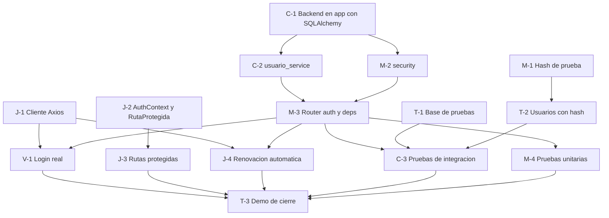

# Daily 3 - Login y roles con backend real

Equipo: Teylork, Magleony, Cristian, Vidal y Jaider (los 5)
Estado: propuesta para confirmar en los primeros 15 minutos del daily
Basado en: Documento Definitivo v2.0 (esquema `sistemas_ar`, 14 tablas, API bajo `/api/v1`)

---

## 0. Instrucciones para el agente de IA (leer primero)

Eres el asistente de UNA persona del equipo. Esa persona te dirá su nombre. Reglas:

1. Lee las secciones 1 a 5 completas antes de escribir código.
2. Ejecuta SOLO las tareas de esa persona (sección 6). No hagas tareas de otros.
3. Edita SOLO los archivos de tus tareas. Si necesitas un cambio en un archivo de otra persona, avísale a la persona para que se lo pida a su dueño.
4. El contrato de la sección 3 es la fuente de verdad. No cambies nombres de campos, rutas ni formatos. Si algo no encaja, avisa y no lo resuelvas por tu cuenta.
5. Los nombres de tablas y columnas salen del esquema v2.0 (`database/mibasededatos.sql`). Léelos de ahí. No inventes campos. Los nombres de tabla se escriben con mayúscula inicial (`Usuario`), porque MySQL en Linux distingue mayúsculas.
6. Nunca escribas contraseñas reales, hashes de cuentas reales, `JWT_SECRET` ni datos de conexión en archivos del repositorio. Van en `.env`, que no se sube. Excepción permitida: el hash de la contraseña de PRUEBA `Prueba123*` dentro de `database/datos_prueba.sql`.
7. Nunca ejecutes SQL destructivo (`DROP`, `TRUNCATE`, `DELETE` sin `WHERE`) en la base compartida sin confirmación escrita de Teylork.
8. Solo Cristian edita `backend/requirements.txt` en este daily. Los demás instalan con `pip install -r requirements.txt` cuando su pull request esté unido.
9. Trabaja en una rama por tarea y entrega con pull request a `develop`. No hagas commit directo a `main` ni a `develop`.
10. Al terminar cada tarea, verifica sus criterios de aceptación (sección 8) y dile a la persona qué probaste y qué falta.

---

## 1. Objetivo y entregables

Dejar funcionando el login de punta a punta con el backend real: el usuario entra con su correo y contraseña, el backend lo valida contra la base `sistemas_ar`, entrega un token que dura 60 minutos más un token de renovación, y el frontend lo lleva al panel de su rol y bloquea las rutas de los otros roles.

Cubre los requisitos RF-01 (login con JWT de 60 minutos y refresh token) y RF-02 (control de acceso por rol). No incluye registro de clientes, recuperación de contraseña ni administración de usuarios: eso va en el daily 4.

Entregables:

- Backend reorganizado en `backend/app/` con SQLAlchemy, como pide el documento.
- Endpoints `POST /api/v1/auth/login`, `POST /api/v1/auth/refresh` y `GET /api/v1/auth/me`.
- Dependencias de seguridad reutilizables para proteger cualquier endpoint por rol.
- Usuarios de prueba con contraseña encriptada en la base compartida y en una base de pruebas.
- Pruebas automáticas (pytest) del hash, los tokens, el login y los roles.
- Frontend con login real, sesión, rutas protegidas por rol, cierre de sesión y renovación automática del token.

---

## 2. Punto de partida (verificar antes de empezar)

Este daily parte de que el daily 2 (las vistas con datos falsos) y el daily de adaptación a la documentación ya están en `develop`. Cada persona verifica lo suyo y, si falta algo, lo termina primero:

| Qué debe existir | Quién verifica |
| --- | --- |
| Base `sistemas_ar` con las 14 tablas, y `database/mibasededatos.sql` y `database/datos_prueba.sql` en el repositorio | Teylork |
| `backend/main.py` plano con `GET /health` y `GET /db-check` funcionando (daily 1) | Cristian |
| `frontend/src/pages/auth/Login.jsx`, `src/routes/rutaPorRol.js`, `src/components/Layout.jsx` y las rutas de `App.jsx` (daily 2) | Vidal y Jaider |
| `src/services/authService.js` con la versión falsa del daily 2 | Vidal |
| `.env` de cada uno con `DB_NAME=sistemas_ar` | Todos |

Todos hacen `git pull origin develop` antes de empezar.

### Estructura del backend al terminar (la del documento)

```text
backend/
├── .env                      # no se sube
├── .env.example
├── requirements.txt
├── app/
│   ├── __init__.py
│   ├── main.py               # app FastAPI, CORS, /health, /db-check y routers
│   ├── core/
│   │   ├── __init__.py
│   │   ├── config.py         # lee .env
│   │   ├── security.py       # hash de contraseñas y tokens JWT
│   │   └── deps.py           # usuario actual y control por rol
│   ├── db/
│   │   ├── __init__.py
│   │   └── database.py       # conexión SQLAlchemy y get_db
│   ├── models/
│   │   ├── __init__.py
│   │   └── usuario.py
│   ├── schemas/
│   │   ├── __init__.py
│   │   └── auth.py
│   ├── services/
│   │   ├── __init__.py
│   │   └── usuario_service.py
│   └── routers/
│       ├── __init__.py
│       └── auth.py
└── tests/
    ├── conftest.py
    ├── test_security.py
    ├── test_roles.py
    └── test_auth.py
```

El backend se arranca desde la carpeta `backend/` con `uvicorn app.main:app --reload`.

---

## 3. Contrato (fuente de verdad)

### Endpoints

| Método y ruta | Quién puede | Qué hace |
| --- | --- | --- |
| `POST /api/v1/auth/login` | Cualquiera | Valida correo y contraseña y entrega los tokens |
| `POST /api/v1/auth/refresh` | Quien tenga un refresh token válido | Entrega un par de tokens nuevo |
| `GET /api/v1/auth/me` | Cualquier usuario con sesión | Devuelve los datos del usuario del token |
| `GET /health` y `GET /db-check` | Cualquiera | Rutas de infraestructura, sin prefijo (las usa la página `Estado`) |

### Login: petición

```json
{
  "correo_electronico": "usuario@ejemplo.com",
  "contrasena": "texto-plano-del-usuario"
}
```

### Login y refresh: respuesta correcta (200)

```json
{
  "access_token": "<jwt de 60 minutos>",
  "refresh_token": "<jwt de renovación>",
  "token_type": "bearer",
  "rol": "cliente",
  "nombre": "Nombre Apellido"
}
```

El campo `rol` va en MINÚSCULA y sin tildes: `cliente`, `tecnico` o `administrador`. En la base el rol se guarda con mayúscula (`Cliente`, `Tecnico`, `Administrador`).

### Refresh: petición

```json
{
  "refresh_token": "<jwt de renovación>"
}
```

### Me: respuesta (200)

```json
{
  "id_usuario": 1,
  "nombre": "Nombre",
  "apellido": "Apellido",
  "correo_electronico": "usuario@ejemplo.com",
  "rol": "cliente"
}
```

### Errores

| Situación | Código | Cuerpo |
| --- | --- | --- |
| Correo inexistente o contraseña incorrecta (misma respuesta en los dos casos) | 401 | `{"detail": "Correo o contraseña incorrectos"}` |
| Contraseña correcta pero `Usuario.estado` es `Inactivo` | 403 | `{"detail": "Cuenta inactiva"}` |
| Falta el token, es inválido o venció | 401 | `{"detail": "Token inválido o vencido"}` |
| Refresh token inválido, vencido o de tipo incorrecto | 401 | `{"detail": "Refresh token inválido o vencido"}` |
| Token válido pero el rol no tiene permiso | 403 | `{"detail": "No tienes permiso para esta acción"}` |

### Tokens JWT

- Algoritmo `HS256`, firmados con `JWT_SECRET`.
- Contenido: `sub` (id del usuario como texto), `rol` (con el valor de la base, por ejemplo `Tecnico`), `tipo` (`access` o `refresh`), `iat` y `exp`.
- El access token dura 60 minutos (RF-01). El refresh token dura 7 días. Los dos tiempos salen del `.env` y son ajustables.
- Un usuario `Inactivo` queda bloqueado en cada petición, aunque su token no haya vencido (HU-ADM-05).

### Sesión en el frontend

Se guarda en `localStorage`, con la clave `sesion`, este objeto: `{ access_token, refresh_token, rol, nombre }`.

### Rutas del frontend por rol

| Rol | Rutas permitidas |
| --- | --- |
| `cliente` | `/cliente` y todo lo que empiece por `/cliente/` |
| `tecnico` | `/tecnico` y todo lo que empiece por `/tecnico/` |
| `administrador` | `/admin` y todo lo que empiece por `/admin/` |

Sin sesión, cualquier ruta protegida lleva a `/login`. Con sesión, entrar a la ruta de otro rol lleva al panel del rol propio (`rutaPorRol`).

### Usuarios de prueba (todos con la contraseña `Prueba123*`)

| Correo | Rol | Estado |
| --- | --- | --- |
| `cliente@prueba.com` | Cliente | Activo |
| `tecnico@prueba.com` | Tecnico | Activo |
| `admin@prueba.com` | Administrador | Activo |
| `inactivo@prueba.com` | Cliente | Inactivo |

---

## 4. Decisiones vigentes (el equipo puede objetarlas en el daily)

| # | Decisión | Motivo |
| --- | --- | --- |
| 1 | Se usan `bcrypt` y `PyJWT` directamente, en lugar de `passlib` y `python-jose` | El documento exige hash bcrypt o argon2, no una librería concreta. `passlib` ya no se actualiza y suele fallar con versiones nuevas de `bcrypt`. Hay que corregir la lista de librerías del documento (sección 7.1) cuando se actualice |
| 2 | Los campos del login se llaman `correo_electronico` y `contrasena`, igual que las columnas de `Usuario` | Evita traducir nombres entre capas |
| 3 | `/health` y `/db-check` se quedan sin prefijo; todo lo funcional va bajo `/api/v1` | La página `Estado` del primer daily sigue funcionando sin cambios |
| 4 | La base guarda el rol con mayúscula y la API lo devuelve en minúscula | Respeta el esquema del documento y simplifica el frontend |
| 5 | Access token de 60 minutos y refresh token de 7 días | RF-01 fija los 60 minutos y pide soporte de refresh; los 7 días son una elección del equipo |
| 6 | La respuesta 403 «Cuenta inactiva» solo se da si la contraseña es correcta | Así no se revela si un correo existe |
| 7 | La sesión se guarda en `localStorage` | Es lo más simple para el proyecto; en producción se podría pasar a cookies `httpOnly` |

---

## 5. Orden y dependencias

### Lista de tareas

| ID | Tarea | Responsable | Depende de |
| --- | --- | --- | --- |
| C-1 | Reorganizar el backend en `app/` con SQLAlchemy, modelo `Usuario`, `.env.example` y `requirements.txt` | Cristian | nada |
| M-1 | Script que genera el hash de la contraseña de prueba, y pasárselo a Teylork | Magleony | nada |
| M-2 | `core/security.py`: hash y tokens | Magleony | C-1 (para ubicar el archivo) |
| T-1 | Crear la base `sistemas_ar_test` con el esquema y los datos de prueba | Teylork | nada (los hashes llegan con T-2) |
| T-2 | Poner el hash real en los usuarios de prueba, agregar `inactivo@prueba.com` y aplicarlo en las dos bases | Teylork | M-1 |
| C-2 | `services/usuario_service.py` | Cristian | C-1 |
| M-3 | `schemas/auth.py`, `core/deps.py` y `routers/auth.py` | Magleony | M-2, C-2 |
| M-4 | Pruebas unitarias de seguridad y de roles | Magleony | M-2, M-3 |
| C-3 | Pruebas de integración del login | Cristian | M-3, T-2 |
| J-1 | Instalar Axios y crear `src/api/client.js` | Jaider | nada |
| J-2 | `AuthContext` y `RutaProtegida` | Jaider | nada |
| V-1 | `authService.js` real y ajustes del `Login.jsx` | Vidal | J-1, M-3 |
| J-3 | Proteger las rutas en `App.jsx` y cerrar sesión en el `Layout` | Jaider | J-2 |
| J-4 | Renovación automática del token | Jaider | J-1, M-3 |
| T-3 | Revisar y unir los pull requests y dirigir la demo | Teylork | todo lo anterior |

### Diagrama



### Orden recomendado de los pull requests

1. C-1 (Cristian), lo antes posible: todo el backend depende de esta estructura.
2. J-1 y J-2 (Jaider): el frontend depende de ellos.
3. C-2 y M-2 (Cristian y Magleony).
4. T-2 (Teylork).
5. M-3 (Magleony).
6. V-1, J-3 y J-4 (Vidal y Jaider).
7. M-4 y C-3 (pruebas).

---

## 6. Tareas por persona

### Cristian (backend: estructura y base de datos)

**C-1. Reorganizar el backend** (rama `feature/backend-estructura-app`)

1. Hacer `git pull origin develop` y crear la rama.
2. Crear las carpetas y los archivos `__init__.py` de la estructura de la sección 2.
3. Instalar las librerías y guardar la lista (solo tú editas `requirements.txt` en este daily):

```bash
pip install fastapi "uvicorn[standard]" sqlalchemy pymysql python-dotenv bcrypt PyJWT pytest httpx
pip freeze > requirements.txt
```

4. Crear `backend/app/core/config.py`:

```python
import os

from dotenv import load_dotenv

load_dotenv()

DB_HOST = os.getenv("DB_HOST")
DB_PORT = os.getenv("DB_PORT", "3306")
DB_USER = os.getenv("DB_USER")
DB_PASSWORD = os.getenv("DB_PASSWORD")
DB_NAME = os.getenv("DB_NAME", "sistemas_ar")

JWT_SECRET = os.getenv("JWT_SECRET")
JWT_ALGORITHM = "HS256"
ACCESS_TOKEN_MINUTES = int(os.getenv("ACCESS_TOKEN_MINUTES", "60"))
REFRESH_TOKEN_DAYS = int(os.getenv("REFRESH_TOKEN_DAYS", "7"))

CORS_ORIGINS = os.getenv("CORS_ORIGINS", "http://localhost:5173").split(",")
```

5. Crear `backend/app/db/database.py` (reemplaza al `database.py` plano del daily 1):

```python
from sqlalchemy import create_engine
from sqlalchemy.engine import URL
from sqlalchemy.orm import DeclarativeBase, sessionmaker

from app.core import config

url = URL.create(
    "mysql+pymysql",
    username=config.DB_USER,
    password=config.DB_PASSWORD,
    host=config.DB_HOST,
    port=int(config.DB_PORT),
    database=config.DB_NAME,
    query={"charset": "utf8mb4"},
)

engine = create_engine(url, pool_pre_ping=True)
SessionLocal = sessionmaker(bind=engine, autoflush=False, autocommit=False)


class Base(DeclarativeBase):
    pass


def get_db():
    db = SessionLocal()
    try:
        yield db
    finally:
        db.close()
```

6. Crear `backend/app/models/usuario.py` con las columnas exactas del esquema v2.0, y dejar `backend/app/models/__init__.py` importándolo:

```python
from datetime import date

from sqlalchemy import Date, Enum, Integer, String
from sqlalchemy.orm import Mapped, mapped_column

from app.db.database import Base


class Usuario(Base):
    __tablename__ = "Usuario"  # con mayúscula, como se creó en MySQL

    id_usuario: Mapped[int] = mapped_column(Integer, primary_key=True, autoincrement=True)
    nombre: Mapped[str] = mapped_column(String(50))
    apellido: Mapped[str] = mapped_column(String(50))
    correo_electronico: Mapped[str] = mapped_column(String(100), unique=True)
    contrasena: Mapped[str] = mapped_column(String(255))
    rol: Mapped[str] = mapped_column(Enum("Cliente", "Administrador", "Tecnico"))
    fecha_registro: Mapped[date] = mapped_column(Date)
    estado: Mapped[str] = mapped_column(Enum("Activo", "Inactivo"), default="Activo")
```

7. Crear `backend/app/main.py` (reemplaza al `main.py` plano). Las rutas de infraestructura se quedan sin prefijo. El router de auth lo agrega Magleony en M-3:

```python
from fastapi import FastAPI
from fastapi.middleware.cors import CORSMiddleware
from sqlalchemy import text

from app.core import config
from app.db.database import engine

app = FastAPI(title="sistemasar.net")

app.add_middleware(
    CORSMiddleware,
    allow_origins=config.CORS_ORIGINS,
    allow_methods=["*"],
    allow_headers=["*"],
)


@app.get("/health")
def health():
    return {"status": "ok"}


@app.get("/db-check")
def db_check():
    with engine.connect() as conexion:
        conexion.execute(text("SELECT 1"))
    return {"database": "ok"}
```

8. Actualizar `backend/.env.example`, sin valores secretos:

```text
DB_HOST=
DB_PORT=3306
DB_USER=
DB_PASSWORD=
DB_NAME=sistemas_ar
JWT_SECRET=
ACCESS_TOKEN_MINUTES=60
REFRESH_TOKEN_DAYS=7
CORS_ORIGINS=http://localhost:5173
TEST_DB_HOST=
TEST_DB_PORT=3306
TEST_DB_USER=
TEST_DB_PASSWORD=
TEST_DB_NAME=sistemas_ar_test
```

9. Borrar el `main.py` y el `database.py` planos del daily 1 y cualquier `usuarios.py` suelto.
10. Probar desde `backend/` con `uvicorn app.main:app --reload`: `/health`, `/db-check` y la página `Estado` del frontend deben seguir funcionando.
11. Subir la rama, abrir el pull request a `develop` y avisar al grupo apenas esté unido.

**C-2. Servicio de usuarios** (rama `feature/backend-usuario-service`)

Crear `backend/app/services/usuario_service.py`:

```python
from sqlalchemy import select
from sqlalchemy.orm import Session

from app.models.usuario import Usuario


def obtener_por_correo(db: Session, correo: str) -> Usuario | None:
    return db.scalar(select(Usuario).where(Usuario.correo_electronico == correo))


def obtener_por_id(db: Session, id_usuario: int) -> Usuario | None:
    return db.get(Usuario, id_usuario)
```

**C-3. Pruebas de integración** (rama `feature/backend-pruebas-auth`)

1. Crear `backend/tests/conftest.py`, que usa la base `sistemas_ar_test`:

```python
import os

import pytest
from fastapi.testclient import TestClient
from sqlalchemy import create_engine
from sqlalchemy.engine import URL
from sqlalchemy.orm import sessionmaker

from app.db.database import get_db
from app.main import app


def _sesiones_de_prueba():
    url = URL.create(
        "mysql+pymysql",
        username=os.getenv("TEST_DB_USER"),
        password=os.getenv("TEST_DB_PASSWORD"),
        host=os.getenv("TEST_DB_HOST"),
        port=int(os.getenv("TEST_DB_PORT", "3306")),
        database=os.getenv("TEST_DB_NAME", "sistemas_ar_test"),
        query={"charset": "utf8mb4"},
    )
    return sessionmaker(bind=create_engine(url, pool_pre_ping=True))


@pytest.fixture()
def client():
    sesiones = _sesiones_de_prueba()

    def get_db_pruebas():
        db = sesiones()
        try:
            yield db
        finally:
            db.close()

    app.dependency_overrides[get_db] = get_db_pruebas
    yield TestClient(app)
    app.dependency_overrides.clear()
```

2. Crear `backend/tests/test_auth.py` con estos casos, usando los usuarios de prueba de la sección 3:
   - Login correcto de cada uno de los 3 roles activos: responde 200 y `rol` en minúscula.
   - Contraseña incorrecta: 401 con el mensaje del contrato.
   - Correo que no existe: 401 con EXACTAMENTE el mismo mensaje.
   - `inactivo@prueba.com` con la contraseña correcta: 403 `Cuenta inactiva`.
   - `GET /api/v1/auth/me` sin token: 401. Con el access token: 200 y los datos del usuario.
   - `POST /api/v1/auth/refresh` con un refresh token válido: 200 con tokens nuevos. Con un access token en lugar del refresh token: 401.
3. Ejecutar `pytest` desde `backend/` y dejar todo en verde.

### Magleony (backend: seguridad y rutas de auth)

**M-1. Hash de la contraseña de prueba** (rama `feature/backend-security`)

1. Crear `backend/generar_hash.py` y ejecutarlo con `python generar_hash.py`:

```python
import bcrypt

contrasena = "Prueba123*"
hash_bytes = bcrypt.hashpw(contrasena.encode("utf-8"), bcrypt.gensalt())
print(hash_bytes.decode("utf-8"))
```

2. Pasarle ese hash a Teylork por mensaje privado de inmediato, porque Teylork lo espera.

**M-2. Hash y tokens** (misma rama, cuando el pull request de C-1 esté unido)

Crear `backend/app/core/security.py`:

```python
from datetime import datetime, timedelta, timezone

import bcrypt
import jwt

from app.core import config


def hashear_contrasena(contrasena: str) -> str:
    return bcrypt.hashpw(contrasena.encode("utf-8"), bcrypt.gensalt()).decode("utf-8")


def verificar_contrasena(contrasena: str, hash_guardado: str) -> bool:
    try:
        return bcrypt.checkpw(contrasena.encode("utf-8"), hash_guardado.encode("utf-8"))
    except ValueError:
        # hash inválido (por ejemplo HASH_PENDIENTE) o contraseña demasiado larga
        return False


def _crear_token(id_usuario: int, rol: str, tipo: str, vigencia: timedelta) -> str:
    ahora = datetime.now(timezone.utc)
    datos = {
        "sub": str(id_usuario),
        "rol": rol,
        "tipo": tipo,
        "iat": ahora,
        "exp": ahora + vigencia,
    }
    return jwt.encode(datos, config.JWT_SECRET, algorithm=config.JWT_ALGORITHM)


def crear_access_token(id_usuario: int, rol: str) -> str:
    return _crear_token(id_usuario, rol, "access", timedelta(minutes=config.ACCESS_TOKEN_MINUTES))


def crear_refresh_token(id_usuario: int, rol: str) -> str:
    return _crear_token(id_usuario, rol, "refresh", timedelta(days=config.REFRESH_TOKEN_DAYS))


def decodificar_token(token: str, tipo: str) -> dict:
    datos = jwt.decode(token, config.JWT_SECRET, algorithms=[config.JWT_ALGORITHM])
    if datos.get("tipo") != tipo:
        raise jwt.InvalidTokenError("Tipo de token incorrecto")
    return datos
```

**M-3. Esquemas, dependencias y router** (rama `feature/backend-auth-router`; requiere C-2 y M-2 unidos)

1. Crear `backend/app/schemas/auth.py`:

```python
from pydantic import BaseModel


class LoginIn(BaseModel):
    correo_electronico: str
    contrasena: str


class RefreshIn(BaseModel):
    refresh_token: str


class TokenOut(BaseModel):
    access_token: str
    refresh_token: str
    token_type: str = "bearer"
    rol: str
    nombre: str


class PerfilOut(BaseModel):
    id_usuario: int
    nombre: str
    apellido: str
    correo_electronico: str
    rol: str
```

2. Crear `backend/app/core/deps.py`:

```python
from typing import Optional

import jwt
from fastapi import Depends, HTTPException
from fastapi.security import HTTPAuthorizationCredentials, HTTPBearer
from sqlalchemy.orm import Session

from app.core.security import decodificar_token
from app.db.database import get_db
from app.models.usuario import Usuario
from app.services import usuario_service

esquema = HTTPBearer(auto_error=False)


def usuario_actual(
    credenciales: Optional[HTTPAuthorizationCredentials] = Depends(esquema),
    db: Session = Depends(get_db),
) -> Usuario:
    if credenciales is None:
        raise HTTPException(status_code=401, detail="Token inválido o vencido")
    try:
        datos = decodificar_token(credenciales.credentials, "access")
    except jwt.PyJWTError:
        raise HTTPException(status_code=401, detail="Token inválido o vencido")

    usuario = usuario_service.obtener_por_id(db, int(datos["sub"]))
    if usuario is None or usuario.estado != "Activo":
        raise HTTPException(status_code=401, detail="Token inválido o vencido")
    return usuario


def requiere_roles(*roles: str):
    def verificar(usuario: Usuario = Depends(usuario_actual)) -> Usuario:
        if usuario.rol not in roles:
            raise HTTPException(status_code=403, detail="No tienes permiso para esta acción")
        return usuario

    return verificar
```

Uso en cualquier endpoint futuro: `Depends(requiere_roles("Administrador"))`, con el rol escrito como en la base.

3. Crear `backend/app/routers/auth.py`:

```python
import jwt
from fastapi import APIRouter, Depends, HTTPException
from sqlalchemy.orm import Session

from app.core.deps import usuario_actual
from app.core.security import (
    crear_access_token,
    crear_refresh_token,
    decodificar_token,
    verificar_contrasena,
)
from app.db.database import get_db
from app.models.usuario import Usuario
from app.schemas.auth import LoginIn, PerfilOut, RefreshIn, TokenOut
from app.services import usuario_service

router = APIRouter(prefix="/api/v1/auth", tags=["auth"])


def _tokens(usuario: Usuario) -> TokenOut:
    return TokenOut(
        access_token=crear_access_token(usuario.id_usuario, usuario.rol),
        refresh_token=crear_refresh_token(usuario.id_usuario, usuario.rol),
        rol=usuario.rol.lower(),
        nombre=f"{usuario.nombre} {usuario.apellido}",
    )


@router.post("/login", response_model=TokenOut)
def login(datos: LoginIn, db: Session = Depends(get_db)):
    usuario = usuario_service.obtener_por_correo(db, datos.correo_electronico)
    if usuario is None or not verificar_contrasena(datos.contrasena, usuario.contrasena):
        raise HTTPException(status_code=401, detail="Correo o contraseña incorrectos")
    if usuario.estado != "Activo":
        raise HTTPException(status_code=403, detail="Cuenta inactiva")
    return _tokens(usuario)


@router.post("/refresh", response_model=TokenOut)
def refrescar(datos: RefreshIn, db: Session = Depends(get_db)):
    try:
        contenido = decodificar_token(datos.refresh_token, "refresh")
    except jwt.PyJWTError:
        raise HTTPException(status_code=401, detail="Refresh token inválido o vencido")

    usuario = usuario_service.obtener_por_id(db, int(contenido["sub"]))
    if usuario is None or usuario.estado != "Activo":
        raise HTTPException(status_code=401, detail="Refresh token inválido o vencido")
    return _tokens(usuario)


@router.get("/me", response_model=PerfilOut)
def perfil(usuario: Usuario = Depends(usuario_actual)):
    return PerfilOut(
        id_usuario=usuario.id_usuario,
        nombre=usuario.nombre,
        apellido=usuario.apellido,
        correo_electronico=usuario.correo_electronico,
        rol=usuario.rol.lower(),
    )
```

4. Registrar el router en `app/main.py` con `from app.routers import auth` y `app.include_router(auth.router)`. Este es el único cambio que haces en un archivo de Cristian; hazlo después de que su pull request esté unido.
5. Probar en `http://127.0.0.1:8000/docs` con los 3 usuarios, con una contraseña incorrecta y con `inactivo@prueba.com`.

**M-4. Pruebas unitarias** (rama `feature/backend-pruebas-seguridad`)

1. `backend/tests/test_security.py`: el hash no es igual a la contraseña en texto plano; `verificar_contrasena` acepta la correcta y rechaza la incorrecta; con un hash inválido devuelve `False` y no lanza error; un access token se decodifica con tipo `access`; un token vencido falla (crear uno con vigencia negativa); un refresh token no se acepta como access token.
2. `backend/tests/test_roles.py`: crear una app de prueba pequeña con un endpoint protegido por `requiere_roles("Administrador")` y simular un usuario de cada rol con `app.dependency_overrides[usuario_actual]`. El administrador recibe 200; el cliente y el técnico reciben 403.
3. Ejecutar `pytest` y dejar todo en verde.

### Teylork (base de datos y líder)

**T-1. Base de pruebas** (rama `feature/db-pruebas`)

1. Crear la base `sistemas_ar_test` en el servidor compartido, con el mismo esquema: ejecutar `database/mibasededatos.sql` sin el `DROP DATABASE` y sin el bloque de permisos, después de cambiar el nombre de la base a `sistemas_ar_test` solo en la copia que ejecutes (el archivo del repositorio no cambia).
2. Verificar que existan las 14 tablas.
3. Pasarle a Cristian los datos de conexión de la base de pruebas para sus variables `TEST_DB_*`, por mensaje privado.

**T-2. Usuarios de prueba con contraseña real** (misma rama, cuando llegue el hash de Magleony)

1. En `database/datos_prueba.sql`, reemplazar `HASH_PENDIENTE` por el hash de la contraseña de prueba que entrega M-1. Es el único hash permitido en el repositorio.
2. Agregar el usuario `inactivo@prueba.com`: una fila en `Usuario` con rol `Cliente` y `estado` `Inactivo`, y su fila en `Cliente`.
3. Verificar que existan los 4 usuarios de la sección 3 con esos correos y roles.
4. Aplicar el cambio en `sistemas_ar` y en `sistemas_ar_test`. En `sistemas_ar` basta actualizar solo lo pendiente, con `WHERE` obligatorio:

```sql
UPDATE Usuario
SET contrasena = 'HASH_DE_LA_CONTRASENA_DE_PRUEBA'
WHERE contrasena = 'HASH_PENDIENTE';
```

5. Avisar al grupo cuando los usuarios estén listos.

**T-3. Revisión y demo**

1. Revisar y unir los pull requests en el orden de la sección 5.
2. Dirigir la demo de la sección 7.
3. Si te faltan vistas del daily 2, continúa con ellas después de tus tareas de arriba.

### Jaider (frontend: infraestructura de sesión)

**J-1. Cliente Axios** (rama `feature/front-api-client`)

1. Instalar Axios con `npm install axios` dentro de `frontend/`. Eres el único que modifica `package.json` en este daily.
2. Crear `src/api/client.js`:

```javascript
import axios from "axios";
import { API_URL } from "../services/api";

export const cliente = axios.create({ baseURL: `${API_URL}/api/v1` });

cliente.interceptors.request.use((config) => {
  const sesion = JSON.parse(localStorage.getItem("sesion") || "null");
  if (sesion?.access_token) {
    config.headers.Authorization = `Bearer ${sesion.access_token}`;
  }
  return config;
});
```

3. Subir este pull request lo antes posible: Vidal lo usa.

**J-2. Contexto de sesión y rutas protegidas** (rama `feature/front-sesion`)

1. Reemplazar o crear `src/context/AuthContext.jsx`, con la sesión del contrato:

```javascript
import { createContext, useContext, useState } from "react";

const AuthContext = createContext(null);

export function AuthProvider({ children }) {
  const [sesion, setSesion] = useState(() => {
    const guardada = localStorage.getItem("sesion");
    return guardada ? JSON.parse(guardada) : null;
  });

  const guardarSesion = (datos) => {
    const nueva = {
      access_token: datos.access_token,
      refresh_token: datos.refresh_token,
      rol: datos.rol,
      nombre: datos.nombre,
    };
    localStorage.setItem("sesion", JSON.stringify(nueva));
    setSesion(nueva);
  };

  const cerrarSesion = () => {
    localStorage.removeItem("sesion");
    setSesion(null);
  };

  return (
    <AuthContext.Provider value={{ sesion, guardarSesion, cerrarSesion }}>
      {children}
    </AuthContext.Provider>
  );
}

export const useAuth = () => useContext(AuthContext);
```

2. Crear `src/routes/RutaProtegida.jsx`, que sirve para envolver varias rutas a la vez:

```javascript
import { Navigate, Outlet } from "react-router-dom";
import { useAuth } from "../context/AuthContext";
import { rutaPorRol } from "./rutaPorRol";

export default function RutaProtegida({ rol, children }) {
  const { sesion } = useAuth();

  if (!sesion) {
    return <Navigate to="/login" replace />;
  }
  if (sesion.rol !== rol) {
    return <Navigate to={rutaPorRol[sesion.rol]} replace />;
  }
  return children ?? <Outlet />;
}
```

**J-3. Proteger las rutas y cerrar sesión** (rama `feature/front-rutas-protegidas`; únicas ediciones permitidas a `App.jsx` y `Layout.jsx` en este daily)

1. En `src/App.jsx`, envolver todo con `AuthProvider` y agrupar las rutas de cada rol con un `RutaProtegida`:

```javascript
<Route element={<RutaProtegida rol="cliente" />}>
  <Route path="/cliente" element={<DashboardCliente />} />
  {/* ...las demás rutas que empiezan por /cliente... */}
</Route>
<Route element={<RutaProtegida rol="tecnico" />}>
  <Route path="/tecnico" element={<DashboardTecnico />} />
  {/* ...las demás rutas que empiezan por /tecnico... */}
</Route>
<Route element={<RutaProtegida rol="administrador" />}>
  <Route path="/admin" element={<DashboardAdmin />} />
  {/* ...las demás rutas que empiezan por /admin... */}
</Route>
```

   Las rutas `/login`, `/recuperar`, `/registro`, `/estado` y `/` no se protegen.
2. En `Layout.jsx`, agregar un botón de cerrar sesión (en el menú del avatar o en el menú lateral) que llame a `cerrarSesion()` y lleve a `/login`. Mostrar el nombre de `sesion.nombre` junto al avatar.
3. Si la vista de login se abre con sesión activa, redirigir al panel del rol (`rutaPorRol[sesion.rol]`).

**J-4. Renovación automática del token** (rama `feature/front-refresh-token`; requiere J-1 y M-3 unidos)

Agregar al final de `src/api/client.js`: si una petición responde 401 y hay refresh token, se pide un par nuevo una sola vez y se repite la petición; si la renovación falla, se cierra la sesión.

```javascript
let renovando = null;

cliente.interceptors.response.use(
  (respuesta) => respuesta,
  async (error) => {
    const original = error.config;
    const sesion = JSON.parse(localStorage.getItem("sesion") || "null");
    const esRutaDeAuth = original.url.includes("/auth/");

    if (error.response?.status === 401 && sesion?.refresh_token && !original._reintentado && !esRutaDeAuth) {
      original._reintentado = true;
      try {
        renovando =
          renovando ||
          axios.post(`${API_URL}/api/v1/auth/refresh`, { refresh_token: sesion.refresh_token });
        const { data } = await renovando;
        renovando = null;
        localStorage.setItem("sesion", JSON.stringify(data));
        original.headers.Authorization = `Bearer ${data.access_token}`;
        return cliente(original);
      } catch (e) {
        renovando = null;
        localStorage.removeItem("sesion");
        window.location.href = "/login";
      }
    }
    return Promise.reject(error);
  }
);
```

### Vidal (frontend: pantalla de login)

**V-1. Login real** (rama `feature/front-login-real`; requiere J-1 y M-3 unidos)

1. Reemplazar `src/services/authService.js` (la versión falsa del daily 2) por la real:

```javascript
import { cliente } from "../api/client";

export async function iniciarSesion(correo_electronico, contrasena) {
  try {
    const { data } = await cliente.post("/auth/login", { correo_electronico, contrasena });
    return data;
  } catch (error) {
    const estado = error.response?.status;
    if (estado === 401) throw new Error("Correo o contraseña incorrectos");
    if (estado === 403) throw new Error("Tu cuenta está inactiva. Habla con el administrador");
    throw new Error("No se pudo conectar con el servidor");
  }
}

export async function obtenerPerfil() {
  const { data } = await cliente.get("/auth/me");
  return data;
}
```

2. En `src/pages/auth/Login.jsx`:
   - Llamar a `iniciarSesion(correo, contrasena)`, guardar la sesión con `guardarSesion(datos)` y navegar con `navigate(rutaPorRol[datos.rol])`.
   - Agregar un estado `cargando`: mientras la petición está en curso, el botón queda deshabilitado y dice «Ingresando...».
   - Mostrar el mensaje de error que llega de `iniciarSesion` debajo del formulario.
3. Mientras el pull request de Magleony (M-3) no esté unido, seguir probando con la versión falsa de `authService.js`, que ya devuelve la forma del contrato.
4. Probar con los 4 usuarios de prueba y con una contraseña incorrecta, mirando la petición en la pestaña Network de las herramientas del navegador (tecla F12).

---

## 7. Demo de cierre

Con todos los pull requests unidos a `develop`, Teylork hace `git pull origin develop`, instala con `pip install -r requirements.txt` y `npm install`, y arranca el backend (`uvicorn app.main:app --reload` en `backend/`) y el frontend (`npm run dev` en `frontend/`). Se prueba, en este orden:

1. `http://127.0.0.1:8000/docs` muestra los endpoints de auth, y la página `/estado` del frontend sigue mostrando «ok» en backend y base de datos.
2. Login en `/login` con `cliente@prueba.com`, `tecnico@prueba.com` y `admin@prueba.com`: cada uno llega al panel de su rol.
3. Contraseña incorrecta: se ve «Correo o contraseña incorrectos». `inactivo@prueba.com` con la contraseña correcta: se ve el mensaje de cuenta inactiva.
4. Con la sesión de cliente abierta, escribir `/admin` en la barra del navegador: lo devuelve a `/cliente`. Sin sesión, entrar a `/cliente` lleva a `/login`.
5. Recargar la página con sesión abierta: la sesión se conserva.
6. Cerrar sesión: vuelve a `/login` y ya no se puede entrar a las rutas protegidas.
7. Renovación del token: poner `ACCESS_TOKEN_MINUTES=1` en el `.env` del backend, reiniciarlo, iniciar sesión, esperar más de un minuto y navegar a otra vista: no debe pedir login de nuevo.
8. `pytest` en `backend/` termina sin fallos.

Si algo no quedó integrado, se muestra lo que sí funciona y se anota lo que falta como primera tarea del día siguiente.

---

## 8. Criterios de aceptación

- El backend arranca con `uvicorn app.main:app --reload` desde `backend/`, y `/health` y `/db-check` responden como antes.
- `POST /api/v1/auth/login` devuelve 200 con los tokens y el rol en minúscula para los 3 roles activos, 401 con el mismo mensaje para correo inexistente y contraseña incorrecta, y 403 para el usuario inactivo.
- `GET /api/v1/auth/me` responde 401 sin token y 200 con un access token válido.
- `POST /api/v1/auth/refresh` acepta solo refresh tokens; con un access token responde 401.
- Un usuario con `estado` `Inactivo` queda bloqueado aunque su token no haya vencido.
- `requiere_roles` deja pasar solo a los roles indicados y responde 403 a los demás.
- Ningún archivo del repositorio contiene contraseñas reales, `JWT_SECRET` ni datos de conexión. El único hash permitido es el de la contraseña de prueba.
- `pytest` pasa en `backend/`.
- El frontend guarda la sesión, redirige por rol, bloquea las rutas de otros roles, permite cerrar sesión y renueva el token automáticamente.
- Cada tarea cumple lo acordado: corre en el computador de quien la hizo, está en su rama, tiene el pull request abierto y otro compañero lo revisó.

---

## 9. Prompts sugeridos para el agente

Cada integrante abre su agente en el proyecto y pega el prompt de su nombre. El documento va guardado en `docs/daily-03-login-roles.md`.

**Teylork**

> Lee `docs/daily-03-login-roles.md`. Soy Teylork. Ejecuta T-1 y T-2 en ese orden, sin ningún SQL destructivo sin mi confirmación escrita, y al final prepárame la lista de revisión de pull requests de T-3. Usa solo los nombres de columna de `database/mibasededatos.sql`.

**Cristian**

> Lee `docs/daily-03-login-roles.md`. Soy Cristian. Ejecuta C-1 primero y deja su pull request listo cuanto antes, porque todo el backend depende de esa estructura. Luego C-2 y C-3. Solo yo edito `requirements.txt` en este daily.

**Magleony**

> Lee `docs/daily-03-login-roles.md`. Soy Magleony. Ejecuta M-1 primero y dame el hash para pasárselo a Teylork. Luego M-2, M-3 y M-4, sin empezar M-2 y M-3 hasta que el pull request de C-1 esté unido. Respeta el contrato de la sección 3.

**Vidal**

> Lee `docs/daily-03-login-roles.md`. Soy Vidal. Ejecuta V-1. Mientras J-1 y M-3 no estén unidos a `develop`, sigue con la versión falsa de `authService.js` pero con la forma exacta del contrato de la sección 3.

**Jaider**

> Lee `docs/daily-03-login-roles.md`. Soy Jaider. Ejecuta J-1 y J-2 primero y sube sus pull requests cuanto antes, porque Vidal los usa. Luego J-3 y J-4. Solo yo modifico `package.json`, `App.jsx` y `Layout.jsx` en este daily.
