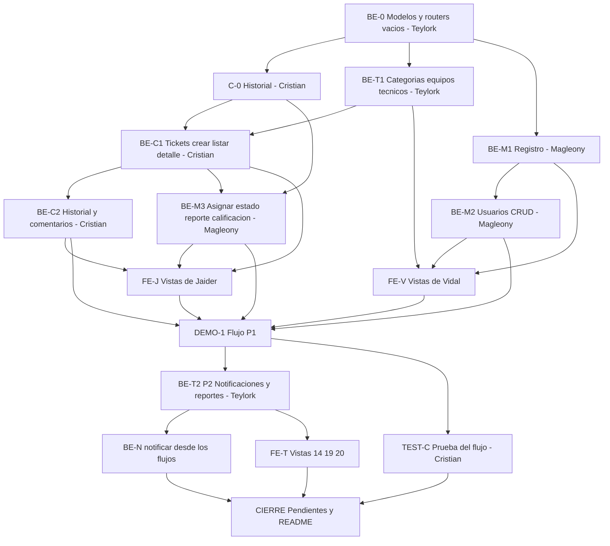

# Daily 4 - Cierre del proyecto

Equipo: Teylork, Magleony, Cristian, Vidal y Jaider (los 5)
Estado: propuesta para confirmar en los primeros 15 minutos del daily
Basado en: Documento Definitivo v2.0 (esquema `sistemas_ar`, 14 tablas, API bajo `/api/v1`)
Contexto: hoy es el último día de Teylork en el proyecto. El día termina con un documento de pendientes para que el resto del equipo continúe.

---

## 0. Instrucciones para el agente de IA (leer primero)

Eres el asistente de UNA persona del equipo. Esa persona te dirá su nombre. Reglas:

1. Lee las secciones 1 a 5 completas antes de escribir código.
2. Ejecuta SOLO las tareas de esa persona (sección 6), en el orden en que aparecen. No hagas tareas de otros.
3. Edita SOLO los archivos de tus tareas. Los archivos de routers, servicios y esquemas ya existen vacíos gracias a BE-0, y cada uno tiene un dueño (sección 4). Si necesitas un cambio en un archivo ajeno, avisa a la persona para que se lo pida a su dueño.
4. El contrato de la sección 3 es la fuente de verdad. No cambies rutas, nombres de campos ni formatos. Si algo no encaja, avisa y no lo resuelvas por tu cuenta.
5. Los nombres de tablas y columnas salen de `database/mibasededatos.sql`. Las respuestas de la API usan los nombres de las columnas y los valores exactos de las enumeraciones (por ejemplo `En_Proceso`, `Critica`). La única excepción es `rol`, que va en minúscula.
6. Nunca escribas contraseñas reales, `JWT_SECRET` ni datos de conexión en archivos del repositorio. Excepción permitida: el hash de la contraseña de PRUEBA `Prueba123*`.
7. Nunca ejecutes SQL destructivo (`DROP`, `TRUNCATE`, `DELETE` sin `WHERE`) en la base compartida sin confirmación escrita de Teylork.
8. Solo Cristian edita `backend/requirements.txt` y solo Jaider edita `frontend/package.json`. Quien necesite una librería nueva se la pide a ellos.
9. Respeta las prioridades de la sección 1: P1 primero, luego P2, luego P3. No empieces una prioridad si la anterior de tus tareas no cumple sus criterios de aceptación.
10. Trabaja en una rama por tarea. Hoy los pull requests deben ser pequeños y unirse rápido: no los acumules. No hagas commit directo a `main` ni a `develop`.
11. Al terminar cada tarea, verifica sus criterios de aceptación (sección 8) y dile a la persona qué probaste y qué falta.

---

## 1. Objetivo y alcance

El Documento Definitivo describe 61 días hábiles de trabajo, y en un día no entra todo. Para que lo más importante quede terminado primero, el trabajo se ordena en tres prioridades. Lo que no entre queda registrado en `docs/PENDIENTES.md` (sección 9).

| Prioridad | Qué incluye | Requisitos del documento |
| --- | --- | --- |
| P1 (obligatorio) | El flujo central de punta a punta: registro de cliente, administración de usuarios, categorías, equipos, crear ticket, listados y detalle según el rol, comentarios, historial automático, asignación de técnico, informe de solución y resolución, calificación y cierre. El frontend conectado al backend en las vistas de ese flujo | RF-03 (registro), RF-04, RF-05, RF-06, RF-07, RF-09, RF-10, RF-11, RF-12, RF-13, RF-14 |
| P2 (si P1 está completo) | Notificaciones internas, reportes en JSON y dashboard del administrador, listado de calificaciones, vistas 14, 19 y 20 conectadas, prueba automática del flujo completo | RF-16 (parte interna), RF-17 (sin exportar), RF-18 |
| P3 (solo si sobra tiempo) | Adjuntos de evidencia, correos por SMTP, recuperación de contraseña real, exportar reportes a PDF y Excel, alerta de tickets de más de 8 horas, disponibilidad del técnico editable, tablero Kanban arrastrable | RF-08, RF-15, RF-16 (SMTP), RF-17 (PDF y Excel), RF-03 (recuperación), HU-SOP-01, HU-SOP-05 |
| Fuera del alcance de hoy | Despliegue en el VPS (Nginx, SSL, systemd), prueba de carga, manuales PDF. Van a `docs/PENDIENTES.md` | Sección 7.3 del documento |

Las vistas de inventario (13 y 18) están fuera del proyecto: el documento no tiene módulo de inventario.

---

## 2. Punto de partida (verificar antes de empezar)

Este daily parte de que el daily 3 está unido a `develop`. Cada persona verifica lo suyo y, si falta algo, lo termina primero:

| Qué debe existir | Quién verifica |
| --- | --- |
| Login real funcionando: `POST /api/v1/auth/login`, `refresh`, `me`, y `requiere_roles` en `app/core/deps.py` | Magleony |
| Backend en `backend/app/` con SQLAlchemy y el modelo `Usuario`, y `pytest` en verde | Cristian |
| Base `sistemas_ar` con las 14 tablas y los usuarios de prueba con hash, y `database/mibasededatos.sql` y `database/datos_prueba.sql` en el repositorio | Teylork |
| Frontend con sesión, rutas protegidas por rol, `src/api/client.js` (Axios) y las vistas del daily 2 con datos falsos en `src/services/` | Jaider y Vidal |

Todos hacen `git pull origin develop` antes de empezar.

---

## 3. Contrato de la API (fuente de verdad)

### 3.1 Reglas generales

- Todas las rutas van bajo `/api/v1` y, salvo las marcadas como públicas, exigen el token `Bearer` del daily 3.
- Los errores tienen el formato `{"detail": "texto"}`. El código 422 (validación de datos) lo genera FastAPI solo.
- Un recurso que el usuario no puede ver (por ejemplo, el ticket de otro cliente) responde 404, no 403. El 403 se usa cuando el ROL no tiene permiso para la acción.
- Las fechas se envían en formato ISO 8601. Las listas de tickets van ordenadas por `fecha_creacion`, de la más reciente a la más antigua.
- `rol` va siempre en minúscula (`cliente`, `tecnico`, `administrador`). El resto de las enumeraciones va como en la base.

### 3.2 Endpoints

| # | Método y ruta | Quién puede | Cuerpo o parámetros | Respuesta | Prioridad |
| --- | --- | --- | --- | --- | --- |
| 1 | `POST /auth/register` | Público | `nombre`, `apellido`, `correo_electronico`, `contrasena` (de 8 a 72 caracteres), `telefono`, `direccion`, `area_departamento` | 201 con `UsuarioOut`. Crea la fila en `Usuario` (rol `Cliente`, estado `Activo`, `fecha_registro` de hoy) y la fila en `Cliente`. 409 si el correo ya existe | P1 |
| 2 | `POST /auth/recuperar` | Público | `correo_electronico` | 200 `{"detail": "Si el correo existe, recibirás instrucciones"}`, siempre la misma respuesta. En P1 no envía nada | P1 (versión real en P3) |
| 3 | `GET /usuarios` | Administrador | Opcional: `rol`, `estado` | Lista de `UsuarioOut` | P1 |
| 4 | `POST /usuarios` | Administrador | Los campos del registro más `rol`, y los datos del subtipo según el rol | 201 con `UsuarioOut`. Crea `Usuario` y la fila del subtipo | P1 |
| 5 | `PUT /usuarios/{id_usuario}` | Administrador | Campos editables, incluido `estado` y una `contrasena` nueva opcional (se guarda con hash) | 200 con `UsuarioOut`. Un administrador no puede inactivarse a sí mismo (400) | P1 |
| 6 | `GET /categorias` | Cualquier usuario con sesión | — | Lista de `CategoriaOut` | P1 |
| 7 | `POST /categorias` | Administrador | `nombre_categoria`, `descripcion` | 201. 409 si el nombre ya existe | P1 |
| 8 | `PUT /categorias/{id_categoria}` | Administrador | `nombre_categoria`, `descripcion` | 200 | P1 |
| 9 | `GET /equipos` | Cliente (los suyos), técnico y administrador (todos, solo lectura para el técnico). Opcional para el administrador: `id_cliente` | — | Lista de `EquipoOut` | P1 |
| 10 | `POST /equipos` | Cliente (se toma `id_cliente` del token) o administrador (debe enviar `id_cliente`) | `tipo`, `marca`, `modelo`, `serial`, `sistema_operativo`, `area_departamento` | 201. 409 si el serial ya existe | P1 |
| 11 | `PUT /equipos/{id_equipo}` | Su cliente dueño o el administrador | Los mismos campos, más `estado_equipo` | 200 | P1 |
| 12 | `GET /tecnicos` | Administrador | — | Lista de `TecnicoOut` | P1 |
| 13 | `POST /tickets` | Cliente | `titulo`, `descripcion`, `modalidad`, `id_equipo` (opcional, debe ser del cliente) y `categorias` (lista de `id_categoria`, mínimo una) | 201 con `TicketOut` | P1 |
| 14 | `GET /tickets` | Todos, filtrado según el rol (sección 3.5). Opcional: `estado`, `prioridad`, `id_tecnico` (solo administrador) | — | Lista de `TicketOut` | P1 |
| 15 | `GET /tickets/{id_ticket}` | Quien pueda ver el ticket | — | `TicketDetalleOut` | P1 |
| 16 | `GET /tickets/{id_ticket}/historial` | Quien pueda ver el ticket | — | Lista de `HistorialOut` | P1 |
| 17 | `GET /tickets/{id_ticket}/comentarios` | Quien pueda ver el ticket | — | Lista de `ComentarioOut`. El cliente no ve las notas internas | P1 |
| 18 | `POST /tickets/{id_ticket}/comentarios` | Cliente (el suyo), técnico asignado, administrador | `contenido`, `es_nota_interna` (por defecto falso; si lo envía un cliente se ignora y queda en falso) | 201 con `ComentarioOut` | P1 |
| 19 | `PATCH /tickets/{id_ticket}/asignar` | Administrador | `id_tecnico`, `prioridad` (opcional) | 200 con `TicketOut` | P1 |
| 20 | `PATCH /tickets/{id_ticket}/estado` | Cliente (el suyo) o administrador | `{"estado_nuevo": "Cerrado"}` | 200 con `TicketOut` | P1 |
| 21 | `POST /tickets/{id_ticket}/reporte` | Técnico asignado | `solucion_aplicada` (no vacío) | 201 con `ReporteOut` | P1 |
| 22 | `POST /tickets/{id_ticket}/calificacion` | Cliente (el suyo) | `puntuacion` (de 1 a 5), `comentario` (opcional) | 201 con `CalificacionOut` | P1 |
| 23 | `GET /calificaciones` | Administrador | Opcional: `id_tecnico`, `desde`, `hasta`, `puntuacion` | Lista de `CalificacionOut` | P2 |
| 24 | `GET /notificaciones` y `PATCH /notificaciones/{id_notificacion}/leida` | Cualquier usuario con sesión (las suyas) | — | Lista de `NotificacionOut` y 200 | P2 |
| 25 | `GET /reportes/{tipo_informe}` | Administrador | `tipo_informe`: `por_agente`, `por_prioridad`, `tiempos_resolucion`, `estado_general` o `incidencias_area_categoria`. Opcional: `desde`, `hasta` | JSON de la sección 3.4 | P2 |
| 26 | `POST /tickets/{id_ticket}/adjuntos` | Cliente (el suyo) o técnico asignado | Archivo `.jpg`, `.png` o `.pdf` de hasta 5 MB, máximo 3 por ticket | 201 | P3 |

### 3.3 Formas de respuesta

| Objeto | Campos |
| --- | --- |
| `UsuarioOut` | `id_usuario`, `nombre`, `apellido`, `correo_electronico`, `rol` (minúscula), `estado`, `fecha_registro`, y según el rol: `telefono`, `direccion`, `area_departamento` (cliente), `especialidad`, `disponibilidad` (técnico) o `cargo` (administrador). Los campos que no aplican van en `null` |
| `CategoriaOut` | `id_categoria`, `nombre_categoria`, `descripcion` |
| `EquipoOut` | `id_equipo`, `tipo`, `marca`, `modelo`, `serial`, `sistema_operativo`, `area_departamento`, `id_cliente`, `estado_equipo` |
| `TecnicoOut` | `id_usuario`, `nombre`, `apellido`, `especialidad`, `disponibilidad`, `tickets_en_proceso` (cantidad) |
| `TicketOut` | `id_ticket`, `titulo`, `descripcion`, `modalidad`, `prioridad`, `estado`, `fecha_creacion`, `fecha_resolucion`, `fecha_cierre`, `id_cliente`, `cliente_nombre`, `id_tecnico`, `tecnico_nombre`, `id_asignado_por`, `id_equipo`, `equipo` (texto «marca modelo» o `null`), `categorias` (lista de `{id_categoria, nombre_categoria}`) |
| `TicketDetalleOut` | Todo `TicketOut` más `reporte` (`ReporteOut` o `null`) y `calificacion` (`CalificacionOut` o `null`) |
| `HistorialOut` | `id_historial`, `id_ticket`, `tipo_accion`, `estado_anterior`, `estado_nuevo`, `fecha_accion`, `id_usuario`, `usuario_nombre`, `detalles` |
| `ComentarioOut` | `id_comentario`, `id_ticket`, `contenido`, `es_nota_interna`, `fecha_creacion`, `id_usuario`, `usuario_nombre`, `rol` |
| `ReporteOut` | `id_reporte`, `id_ticket`, `id_tecnico`, `solucion_aplicada`, `fecha_reporte`, `estado` |
| `CalificacionOut` | `id_calificacion`, `id_ticket`, `id_cliente`, `cliente_nombre`, `id_tecnico`, `tecnico_nombre`, `puntuacion`, `comentario`, `fecha_calificacion` |
| `NotificacionOut` | `id_notificacion`, `mensaje`, `tipo`, `leida`, `fecha_envio`, `id_ticket` |

Los nombres (`cliente_nombre`, `tecnico_nombre`, `usuario_nombre`) son «nombre apellido» del usuario correspondiente.

### 3.4 Informes de `GET /reportes/{tipo_informe}` (P2)

| `tipo_informe` | Respuesta |
| --- | --- |
| `por_agente` | Lista de `{id_tecnico, tecnico_nombre, total, resueltos, cerrados}` |
| `por_prioridad` | Lista de `{prioridad, total}` |
| `tiempos_resolucion` | `{promedio_horas, tickets: [{id_ticket, horas}]}`, solo con tickets que tengan `fecha_resolucion` |
| `estado_general` | `{tickets_totales, abiertos, cerrados, tecnicos_activos, por_estado: [{estado, total}], serie_semanal: [{semana, abiertos, cerrados}]}`. «Abiertos» son los tickets que no están en estado `Cerrado`. «Técnicos activos» son los de `disponibilidad` distinta de `Fuera_de_Servicio` |
| `incidencias_area_categoria` | Lista de `{area_departamento, nombre_categoria, total}` |

### 3.5 Máquina de estados del ticket

| Transición | Quién | Endpoint | Efectos (todo en una sola transacción) |
| --- | --- | --- | --- |
| Nuevo → `Abierto` | Cliente | `POST /tickets` | Prioridad `Media`. Historial `Creacion` |
| `Abierto` → `En_Proceso` | Administrador | `PATCH /tickets/{id}/asignar` | Guarda `id_tecnico`, `id_asignado_por` y la prioridad si se envió. Historial `Asignacion` |
| `En_Proceso` → `En_Proceso` (reasignar) | Administrador | `PATCH /tickets/{id}/asignar` | Cambia el técnico. Historial `Asignacion` con el mismo estado anterior y nuevo |
| `En_Proceso` → `Resuelto` | Técnico asignado | `POST /tickets/{id}/reporte` | Crea el `Reporte` (estado `Aprobado`) y guarda `fecha_resolucion`. Historial `Resolucion` |
| `Resuelto` → `Cerrado` | Cliente | `POST /tickets/{id}/calificacion` | Crea la `Calificacion` (una sola por ticket; 409 si ya existe) y guarda `fecha_cierre`. Historial `Cierre` |
| `Resuelto` → `Cerrado` sin calificar | Cliente o administrador | `PATCH /tickets/{id}/estado` | Guarda `fecha_cierre`. Historial `Cierre`. La calificación es opcional |

Cualquier otra transición responde 400 `{"detail": "El ticket no está en un estado válido para esta acción"}`.

Reglas de asignación (400 con el mensaje indicado):

- El técnico debe existir, tener la cuenta `Activa` y una `disponibilidad` distinta de `Fuera_de_Servicio`: «El técnico no está disponible».
- La prioridad, si se envía, debe ser `Baja`, `Media`, `Alta` o `Critica`. Solo el administrador la cambia.

Regla de resolución: sin `solucion_aplicada` (vacía o solo espacios) responde 400 «Debes registrar la solución aplicada».

### 3.6 Qué ve cada rol

| Rol | Tickets | Comentarios | Equipos |
| --- | --- | --- | --- |
| `cliente` | Solo los suyos | Sin notas internas | Solo los suyos |
| `tecnico` | Solo los que tienen `id_tecnico` igual a su id | Todos, incluidas las notas internas | Todos, de solo lectura |
| `administrador` | Todos | Todos | Todos |

### 3.7 Historial y notificaciones

- Cada creación, asignación, resolución, cierre y comentario inserta una fila en `Historial_Ticket` (`registrar_historial`), con la fecha y el usuario responsable.
- (P2) Notificaciones internas, con la función `notificar` de `notificacion_service.py`:

| Evento | Quién recibe | `tipo` |
| --- | --- | --- |
| Ticket creado | Administradores activos | `Actualizacion` |
| Asignación | El técnico y el cliente | `Asignacion` |
| Comentario | La otra parte del ticket (si lo escribe el cliente, el técnico asignado; si lo escribe el técnico, el cliente salvo en notas internas) | `Comentario` |
| Resolución | El cliente | `Resolucion` |
| Cierre | El técnico y los administradores | `Actualizacion` |
| Calificación de 2 estrellas o menos | Administradores activos | `Actualizacion` |

---

## 4. Backend: estructura y patrones

### 4.1 Estructura al terminar (se suma a la del daily 3)

```text
backend/app/
├── models/        # un archivo por tabla (BE-0)
├── schemas/
│   ├── auth.py
│   ├── usuario.py        # Magleony
│   ├── catalogo.py       # Teylork: categorías, equipos y técnicos
│   ├── ticket.py         # Cristian: tickets, historial y comentarios
│   ├── flujo.py          # Magleony: asignar, estado, reporte y calificación
│   └── reportes.py       # Teylork
├── services/
│   ├── usuario_service.py        # Magleony
│   ├── catalogo_service.py       # Teylork
│   ├── historial_service.py      # Cristian (C-0)
│   ├── ticket_service.py         # Cristian
│   ├── flujo_service.py          # Magleony
│   ├── notificacion_service.py   # Teylork (P2)
│   └── reporte_service.py        # Teylork (P2)
└── routers/
    ├── auth.py             # Magleony
    ├── usuarios.py         # Magleony
    ├── categorias.py       # Teylork
    ├── equipos.py          # Teylork
    ├── tecnicos.py         # Teylork
    ├── tickets.py          # Cristian: crear, listar, detalle, historial y comentarios
    ├── tickets_flujo.py    # Magleony: asignar, estado, reporte y calificación (mismo prefijo /api/v1/tickets)
    ├── calificaciones.py   # Teylork (P2)
    ├── notificaciones.py   # Teylork (P2)
    └── reportes.py         # Teylork (P2)
```

### 4.2 BE-0 (lo primero del día, lo hace Teylork)

1. Un modelo SQLAlchemy por cada tabla que aún no tiene, con las columnas, tipos, claves foráneas y enumeraciones EXACTOS de `database/mibasededatos.sql`. Los nombres de clase y de archivo son:

| Tabla | Clase | Archivo en `app/models/` |
| --- | --- | --- |
| `Cliente` | `Cliente` | `cliente.py` |
| `Administrador` | `Administrador` | `administrador.py` |
| `Tecnico` | `Tecnico` | `tecnico.py` |
| `Categoria` | `Categoria` | `categoria.py` |
| `Equipo` | `Equipo` | `equipo.py` |
| `Ticket` | `Ticket` | `ticket.py` |
| `Ticket_Categoria` | `TicketCategoria` | `ticket_categoria.py` |
| `Adjunto_Ticket` | `AdjuntoTicket` | `adjunto_ticket.py` |
| `Historial_Ticket` | `HistorialTicket` | `historial_ticket.py` |
| `Comentario` | `Comentario` | `comentario.py` |
| `Reporte` | `Reporte` | `reporte.py` |
| `Notificacion` | `Notificacion` | `notificacion.py` |
| `Calificacion` | `Calificacion` | `calificacion.py` |

2. Reglas de los modelos: `__tablename__` con el nombre exacto de la tabla (con mayúscula inicial y guion bajo, por ejemplo `"Historial_Ticket"`); las columnas con `DEFAULT` en el DDL llevan `server_default` (por ejemplo `fecha_creacion` con `func.now()` y `estado` con `"Abierto"`); y `app/models/__init__.py` importa todos los modelos.
3. Crear los archivos vacíos de routers, servicios y esquemas de la sección 4.1. Cada router vacío declara `router = APIRouter(prefix="/api/v1/<recurso>", tags=["<recurso>"])`, y `tickets_flujo.py` usa el mismo prefijo `/api/v1/tickets`.
4. Registrar TODOS los routers en `app/main.py` en una sola vez, para que nadie más edite ese archivo hoy.
5. Verificar que `uvicorn app.main:app --reload` arranca y que `/docs` carga, y subir este pull request de inmediato.

### 4.3 Patrón de transacción (ejemplo: crear ticket)

Cada operación que escribe en varias tablas confirma UNA sola vez al final, para que sea todo o nada:

```python
from sqlalchemy.orm import Session

from app.models.ticket import Ticket
from app.models.ticket_categoria import TicketCategoria
from app.services.historial_service import registrar_historial


def crear_ticket(db: Session, id_cliente: int, datos) -> Ticket:
    ticket = Ticket(
        titulo=datos.titulo,
        descripcion=datos.descripcion,
        modalidad=datos.modalidad,
        id_cliente=id_cliente,
        id_equipo=datos.id_equipo,
    )
    db.add(ticket)
    db.flush()  # obtiene id_ticket sin confirmar todavía

    for id_categoria in datos.categorias:
        db.add(TicketCategoria(id_ticket=ticket.id_ticket, id_categoria=id_categoria))

    registrar_historial(
        db, ticket.id_ticket, "Creacion", id_cliente,
        estado_nuevo="Abierto", detalles="Ticket creado",
    )
    db.commit()
    db.refresh(ticket)
    return ticket
```

### 4.4 Ayudante de historial (C-0, lo hace Cristian)

`backend/app/services/historial_service.py`. No hace `commit`: quien lo llama confirma toda la operación junto.

```python
from sqlalchemy.orm import Session

from app.models.historial_ticket import HistorialTicket


def registrar_historial(
    db: Session,
    id_ticket: int,
    tipo_accion: str,
    id_usuario: int,
    estado_anterior: str | None = None,
    estado_nuevo: str | None = None,
    detalles: str | None = None,
) -> None:
    db.add(
        HistorialTicket(
            id_ticket=id_ticket,
            tipo_accion=tipo_accion,
            estado_anterior=estado_anterior,
            estado_nuevo=estado_nuevo,
            id_usuario=id_usuario,
            detalles=detalles,
        )
    )
```

### 4.5 Frontend: cambiar un servicio falso por uno real

Las vistas no se tocan: solo cambia el cuerpo de las funciones de `src/services/`, que pasan de devolver datos falsos a llamar al backend con el cliente Axios del daily 3. Las respuestas ya traen los nombres de las columnas, igual que los datos falsos del daily 2.

```javascript
import { cliente } from "../api/client";

export async function listarTickets(filtros = {}) {
  const { data } = await cliente.get("/tickets", { params: filtros });
  return data;
}

export async function obtenerTicket(id) {
  const { data } = await cliente.get(`/tickets/${id}`);
  return data;
}
```

Reglas para el frontend:

- Los errores del backend llegan como `error.response.data.detail`. Cada vista muestra ese texto al usuario.
- Mientras el endpoint de una función no esté unido a `develop`, esa función sigue con datos falsos. Se cambia función por función, no archivo por archivo.
- El código del ticket que se muestra es `"TKT-"` más `id_ticket`.

---

## 5. Orden y dependencias

### Lista de tareas

| ID | Tarea | Responsable | Depende de | Prioridad |
| --- | --- | --- | --- | --- |
| BE-0 | Modelos de las 13 tablas, archivos vacíos y routers registrados en `main.py` | Teylork | nada | P1 |
| C-0 | `historial_service.py` | Cristian | BE-0 | P1 |
| BE-T1 | Categorías, equipos y técnicos | Teylork | BE-0 | P1 |
| BE-M1 | Registro y `recuperar` (versión simple) | Magleony | BE-0 | P1 |
| BE-M2 | CRUD de usuarios | Magleony | BE-M1 | P1 |
| BE-C1 | Tickets: crear, listar y detalle | Cristian | C-0, BE-T1 (necesita categorías y equipos para probar) | P1 |
| BE-C2 | Historial y comentarios | Cristian | BE-C1 | P1 |
| BE-M3 | Asignar, estado, reporte y calificación | Magleony | C-0, BE-C1 | P1 |
| FE-V | Servicios y vistas de Vidal conectados (2, 3, 4, 9, 15 y 17) | Vidal | Los endpoints de cada función | P1 |
| FE-J | Servicios y vistas de Jaider conectados (5, 6, 7, 8, 10, 11, 12 y 16) | Jaider | Los endpoints de cada función | P1 |
| DEMO-1 | Demo del flujo P1 (sección 7) | Todos | Todo lo anterior de P1 | P1 |
| BE-T2 | Notificaciones, reportes y listado de calificaciones | Teylork | DEMO-1 | P2 |
| BE-N | Llamar a `notificar` desde los flujos (comentario, asignación, reporte, calificación) | Cristian y Magleony | BE-T2 | P2 |
| FE-T | Vistas 14, 19 y 20 conectadas, y campana de notificaciones | Teylork y Jaider | BE-T2 | P2 |
| TEST-C | Prueba automática del flujo completo | Cristian | DEMO-1 | P2 |
| CIERRE | `docs/PENDIENTES.md` y `README.md` | Teylork | Lo que se haya terminado | Obligatorio |

### Puntos de control

| Control | Condición | Qué habilita |
| --- | --- | --- |
| 1 | BE-0 y C-0 unidos a `develop` | Todo el backend P1 en paralelo |
| 2 | BE-T1, BE-M1, BE-M2, BE-C1, BE-C2 y BE-M3 unidos | El frontend puede cambiar todas sus funciones a reales y se puede hacer la demo P1 |
| 3 | DEMO-1 completa, sin fallos | Empezar P2 |
| 4 | P2 terminado, o decisión de recortarlo | P3 solo si sobra tiempo; lo demás pasa a `docs/PENDIENTES.md` |
| 5 | Cierre | `docs/PENDIENTES.md` y `README.md` completos y unidos |

El frontend no espera al control 2 para empezar: cambia cada función a real apenas su endpoint esté unido.

### Diagrama



### Orden recomendado de los pull requests

1. BE-0 (Teylork) y C-0 (Cristian), apenas estén listos.
2. BE-T1, BE-M1 y BE-C1.
3. BE-M2, BE-C2 y BE-M3.
4. Los pull requests del frontend, función por función, a medida que los endpoints se unan.
5. P2 y, al final, el cierre.

---

## 6. Tareas por persona

### Teylork (base de datos, backend de catálogos, reportes y cierre)

**BE-0. Modelos y routers vacíos** (rama `feature/backend-modelos-base`) — lo primero del día, bloquea a todos. Sigue la sección 4.2.

**BE-T1. Categorías, equipos y técnicos** (rama `feature/backend-catalogos`; P1)

1. `schemas/catalogo.py`, `services/catalogo_service.py` y los routers `categorias.py`, `equipos.py` y `tecnicos.py`, con los endpoints 6 a 12 de la sección 3.2 y las formas de la sección 3.3.
2. Reglas: categorías solo se crean y se editan (no se borran ni se inactivan). Un cliente solo ve y edita los equipos propios, y al crear uno se toma `id_cliente` del token; un administrador debe enviar `id_cliente`. El serial es único (409 «Ya existe un equipo con ese serial»). `GET /tecnicos` calcula `tickets_en_proceso` contando los tickets del técnico en estado `En_Proceso`.
3. Proteger cada endpoint con `usuario_actual` o `requiere_roles(...)`.

**BE-T2. Notificaciones, reportes y calificaciones** (rama `feature/backend-reportes`; P2, después de DEMO-1)

1. `services/notificacion_service.py` con `notificar(db, id_usuario_destino, id_ticket, tipo, mensaje)`, que inserta en `Notificacion` y NO hace `commit` (como `registrar_historial`). Avisa a Cristian y Magleony cuando esté unido para que lo llamen según la tabla de la sección 3.7.
2. Router `notificaciones.py`: listar las propias y marcar como leída (endpoint 24).
3. `services/reporte_service.py` y router `reportes.py`: los 5 informes de la sección 3.4, con consultas SQL de agregación y los filtros `desde` y `hasta`. `estado_general` alimenta el dashboard.
4. Router `calificaciones.py`: endpoint 23, con los nombres del cliente y del técnico.

**FE-T. Vistas 14, 19 y 20** (rama `feature/front-reportes`; P2)

1. Crear `src/services/reportesService.js` y conectar el dashboard (vista 14) con `estado_general`, la vista 19 con los informes y la vista 20 con `GET /calificaciones`.
2. Acordar con Jaider quién agrega la campana de notificaciones al `Layout` (solo Jaider edita `Layout.jsx`).

**CIERRE. `docs/PENDIENTES.md` y `README.md`** (rama `feature/docs-cierre`; obligatorio)

Sigue la sección 9. Se hace al final, con lo que realmente quedó terminado.

**Revisión continua:** revisar y unir los pull requests en el orden de la sección 5, y dirigir las demos.

### Cristian (backend: tickets)

**C-0. Ayudante de historial** (rama `feature/backend-historial-service`) — apenas BE-0 esté unido. Copia el código de la sección 4.4 y súbelo de inmediato, porque Magleony lo usa.

**BE-C1. Tickets: crear, listar y detalle** (rama `feature/backend-tickets`; P1)

1. `schemas/ticket.py` con `TicketOut` y `TicketDetalleOut` (sección 3.3), `services/ticket_service.py` y `routers/tickets.py` con los endpoints 13, 14 y 15.
2. `POST /tickets`: sigue el patrón de la sección 4.3. Valida que haya al menos una categoría, que las categorías existan y que el equipo, si se envía, sea del cliente.
3. `GET /tickets` filtra según el rol (sección 3.6) y acepta `estado`, `prioridad` e `id_tecnico` (este último solo para el administrador). `GET /tickets/{id}` responde 404 si el usuario no puede ver el ticket.
4. Los textos `cliente_nombre`, `tecnico_nombre` y `equipo` se arman en el servicio.

**BE-C2. Historial y comentarios** (misma rama o una nueva; P1)

1. Endpoints 16, 17 y 18 en `routers/tickets.py`.
2. Un comentario del cliente nunca es nota interna (se ignora el valor enviado). El cliente no recibe las notas internas al listar. Cada comentario registra un evento `Comentario` en el historial.

**BE-N. Notificaciones desde los tickets** (P2, cuando BE-T2 esté unido): llamar a `notificar` en la creación del ticket y en los comentarios, según la sección 3.7.

**TEST-C. Prueba automática del flujo completo** (rama `feature/backend-prueba-flujo`; P2)

Un solo test en `backend/tests/test_flujo.py`, con la base `sistemas_ar_test`, que recorra: el cliente crea un ticket con dos categorías, el administrador lo asigna a un técnico disponible con prioridad `Alta`, el técnico comenta y registra el reporte, y el cliente califica con 4 estrellas. Comprueba el estado final `Cerrado`, que el historial tenga 4 eventos (`Creacion`, `Asignacion`, `Resolucion`, `Cierre`) y que cada rol reciba 403 o 404 en lo que no le corresponde.

**Dueño de `requirements.txt`:** si P3 necesita librerías nuevas (por ejemplo `openpyxl` o `reportlab`), las agregas tú.

### Magleony (backend: cuentas y flujo del ticket)

**BE-M1. Registro y recuperación simple** (rama `feature/backend-registro`; P1)

1. `schemas/usuario.py`, ampliar `services/usuario_service.py` y `routers/auth.py` con los endpoints 1 y 2.
2. `POST /auth/register`: valida la longitud de la contraseña (8 a 72), crea `Usuario` y `Cliente` en una sola transacción, y responde 409 «El correo ya está registrado» si el correo existe.
3. `POST /auth/recuperar`: responde siempre lo mismo, exista o no el correo, y por ahora no envía nada.

**BE-M2. Administración de usuarios** (rama `feature/backend-usuarios`; P1)

1. `routers/usuarios.py` con los endpoints 3, 4 y 5, todos con `requiere_roles("Administrador")`.
2. `POST /usuarios` crea `Usuario` y la fila de su subtipo (`Cliente`, `Tecnico` o `Administrador`) en una sola transacción. `PUT` cambia datos, `estado` y, si se envía, la contraseña con hash. Un administrador no puede inactivarse a sí mismo.

**BE-M3. Asignar, cerrar, reporte y calificación** (rama `feature/backend-flujo`; P1; requiere C-0 y BE-C1 unidos)

1. `schemas/flujo.py`, `services/flujo_service.py` y `routers/tickets_flujo.py` con los endpoints 19, 20, 21 y 22.
2. Aplica exactamente la máquina de estados, las reglas de asignación y de resolución de la sección 3.5, y registra cada cambio con `registrar_historial` dentro de la misma transacción.
3. `POST /tickets/{id}/reporte`: el técnico debe ser el asignado y el ticket debe estar `En_Proceso`. `POST /tickets/{id}/calificacion`: el cliente debe ser el dueño y el ticket debe estar `Resuelto`; el `id_tecnico` de la calificación sale del ticket.

**BE-N. Notificaciones desde el flujo** (P2, cuando BE-T2 esté unido): llamar a `notificar` en asignación, resolución, cierre y calificación de 2 estrellas o menos, según la sección 3.7.

### Vidal (frontend: cuentas, cliente y catálogos)

**FE-V** (una rama por vista; P1). Sigue la sección 4.5 y cambia cada función falsa por la real apenas su endpoint esté unido:

1. `authService.js`: agregar `registrarCliente(datos)` (`POST /auth/register`) y `recuperarContrasena(correo)` (`POST /auth/recuperar`). Vista 3 (registro): validar los campos y mostrar el 409 del correo repetido. Vista 2 (recuperar): mostrar siempre el mensaje de confirmación.
2. `equiposService.js` (o el servicio de cliente): `GET`, `POST` y `PUT` de `/equipos`. Vista 9 (perfil del cliente): los datos de `GET /auth/me` y la lista y alta de equipos del cliente.
3. Vista 4 (dashboard del cliente): usar `listarTickets()` de Jaider para contar los tickets por estado. Si ese servicio aún no está unido, esperar a que lo esté o usar datos falsos temporales.
4. `usuariosService.js`: `GET`, `POST` y `PUT` de `/usuarios`. Vista 15 (gestión de usuarios): listar, crear, editar y cambiar el estado, con el formulario según el rol.
5. `categoriasService.js`: `GET`, `POST` y `PUT` de `/categorias`. Vista 17: lista y modal de crear y editar con `nombre_categoria` y `descripcion`, sin borrar ni inactivar.

### Jaider (frontend: tickets y operación)

**FE-J** (una rama por vista; P1). Sigue la sección 4.5:

1. `ticketsService.js`: `listarTickets(filtros)`, `obtenerTicket(id)`, `crearTicket(datos)`, `obtenerHistorial(id)`, `obtenerComentarios(id)`, `comentar(id, datos)`, `calificar(id, datos)` y `cerrarTicket(id)`. Súbelo primero: Vidal usa `listarTickets`.
2. Vista 6 (mis tickets), con el filtro por estado enviado como parámetro.
3. Vista 5 (crear ticket): categorías desde `GET /categorias`, equipos propios desde `GET /equipos`, y el envío con el cuerpo del endpoint 13. Puede elegir varias categorías.
4. Vista 7 (detalle del ticket): `TicketDetalleOut`, el historial y los comentarios, con un formulario para comentar.
5. Vista 8 (calificar): `calificar` y, para omitir, `cerrarTicket`. La calificación es opcional.
6. `tecnicoService.js`: los tickets del técnico salen de `listarTickets()`, y `registrarReporte(id, solucion_aplicada)` hace `POST /tickets/{id}/reporte`. Vista 10 (dashboard del técnico), vista 11 (detalle del ticket asignado, con el botón de resolver que abre el campo de la solución aplicada) y vista 12 (actualizar avance: comentarios y notas internas con `es_nota_interna`).
7. `adminService.js`: `listarTicketsPendientes()` (`GET /tickets?estado=Abierto`), `listarTecnicos()` (`GET /tecnicos`) y `asignarTecnico(id, datos)` (`PATCH /tickets/{id}/asignar`). Vista 16 (asignación): mostrar el mensaje de error si el técnico no está disponible.
8. (P2) Agregar la campana de notificaciones al `Layout` con `GET /notificaciones`, y marcar como leídas.

---

## 7. Flujo de demo (DEMO-1, antes de pasar a P2)

Con todos los pull requests de P1 unidos a `develop`, Teylork hace `git pull origin develop`, instala con `pip install -r requirements.txt` y `npm install`, y arranca el backend y el frontend. Se recorre:

1. Registro: un cliente nuevo (`nuevo@prueba.com`) se registra en `/registro`, inicia sesión y llega a su panel.
2. Equipos y ticket: en su perfil registra un equipo; luego crea un ticket con dos categorías y ese equipo. El ticket aparece en «Mis tickets» con estado `Abierto`.
3. Asignación: el administrador (`admin@prueba.com`) ve el ticket pendiente, ve los técnicos con su disponibilidad, asigna uno disponible y sube la prioridad a `Alta`. Un técnico `Fuera_de_Servicio` no se deja elegir.
4. Operación: el técnico (`tecnico@prueba.com`) ve el ticket, escribe un comentario público y una nota interna, y lo resuelve con la solución aplicada. Sin escribir la solución, no se puede resolver.
5. Cierre: el cliente abre el ticket y ve el historial con los 4 eventos y el comentario público, pero no la nota interna. Califica con 4 estrellas y el ticket pasa a `Cerrado`.
6. Cierre sin calificar: con otro ticket resuelto, el cliente omite la calificación y el ticket también queda `Cerrado`.
7. Administración: el administrador crea y edita una categoría, crea un usuario técnico, inactiva a `inactivo@prueba.com` y comprueba que ese usuario ya no puede entrar.
8. Permisos: el cliente no ve tickets de otro cliente (404) ni entra a las rutas de otros roles.

Solo cuando esta demo salga completa se empieza P2. Para P2, la demo agrega: el dashboard del administrador con datos reales, los informes de la vista 19, el listado de calificaciones, las notificaciones en la campana y `pytest` en verde.

---

## 8. Criterios de aceptación

- BE-0: `uvicorn app.main:app --reload` arranca, `/docs` muestra todos los routers registrados y existen los modelos de las 14 tablas con las columnas del DDL.
- Cada endpoint de P1 responde exactamente con los campos de la sección 3.3 y respeta los roles de la sección 3.2: 401 sin token, 403 con un rol sin permiso, 404 para un recurso que el usuario no puede ver.
- Crear un ticket guarda `Ticket`, `Ticket_Categoria` e `Historial_Ticket` en una sola transacción: si algo falla, no queda nada guardado.
- Un ticket solo recorre las transiciones de la sección 3.5. Cualquier otra responde 400.
- Resolver sin `solucion_aplicada` responde 400. Asignar a un técnico `Fuera_de_Servicio` o inactivo responde 400.
- Una segunda calificación para el mismo ticket responde 409.
- El cliente no ve notas internas y nunca puede crearlas.
- El registro rechaza correos repetidos (409) y contraseñas fuera de 8 a 72 caracteres.
- Ninguna función de `src/services/` de las vistas de P1 devuelve datos falsos al final del día.
- Ningún archivo del repositorio contiene contraseñas reales, `JWT_SECRET` ni datos de conexión.
- Cada tarea cumple lo acordado: corre en el computador de quien la hizo, está en su rama, tiene el pull request abierto y otra persona lo revisó.

---

## 9. Cierre: `docs/PENDIENTES.md` y `README.md` (Teylork)

Al final del día, con lo que realmente quedó hecho, el agente de Teylork crea `docs/PENDIENTES.md` y actualiza `README.md`. Sin ningún secreto en ninguno de los dos.

`docs/PENDIENTES.md` debe tener:

1. Una tabla con los 18 requisitos (RF-01 a RF-18), con su estado (`Hecho`, `Parcial` o `Pendiente`) y una nota corta de qué falta. Se llena revisando el código y las rutas que existen, no de memoria.
2. La lista de pendientes ordenada por prioridad: primero lo de P2 y P3 que no se terminó, y después lo que quedó fuera del alcance (despliegue en el VPS con Nginx, SSL y systemd, prueba de carga con Locust, manuales técnico, de instalación y de usuario).
3. Los desfases entre el proyecto y el Documento Definitivo, por ejemplo: «inactivar categorías» (RF-06) no existe porque `Categoria` no tiene columna de estado; el uso de `bcrypt` y `PyJWT` en lugar de `passlib` y `python-jose`; y las vistas de inventario eliminadas.
4. Cómo ejecutar todo desde cero: crear la base con `database/mibasededatos.sql` y `database/datos_prueba.sql`, las variables del `.env` (solo los nombres, desde `.env.example`), arrancar el backend y el frontend, y correr `pytest`.
5. Los usuarios de prueba (correos y la contraseña de prueba) y las convenciones del equipo (ramas, pull requests, quién edita qué archivos).
6. Los siguientes pasos recomendados, en orden.

`README.md`: qué es el proyecto, el stack, cómo ejecutarlo y un enlace a `docs/PENDIENTES.md`.

---

## 10. Prompts sugeridos para el agente

Cada integrante abre su agente en el proyecto y pega el prompt de su nombre. El documento va guardado en `docs/daily-04-cierre-proyecto.md`.

**Teylork**

> Lee `docs/daily-04-cierre-proyecto.md`. Soy Teylork. Ejecuta BE-0 primero y deja su pull request listo cuanto antes, porque todos esperan. Luego BE-T1. Cuando se cumpla el control 3, sigue con BE-T2 y FE-T. Al final haz CIERRE. No ejecutes ningún SQL destructivo sin mi confirmación escrita.

**Cristian**

> Lee `docs/daily-04-cierre-proyecto.md`. Soy Cristian. Cuando el pull request de BE-0 esté unido, haz C-0 y súbelo de inmediato. Luego BE-C1 y BE-C2. Después de DEMO-1, haz TEST-C y BE-N. Solo yo edito `requirements.txt`. Respeta el contrato de la sección 3.

**Magleony**

> Lee `docs/daily-04-cierre-proyecto.md`. Soy Magleony. Cuando el pull request de BE-0 esté unido, haz BE-M1 y BE-M2. BE-M3 empieza cuando C-0 y BE-C1 estén unidos. Después de DEMO-1, haz BE-N. Respeta el contrato de la sección 3 y la máquina de estados de la sección 3.5.

**Vidal**

> Lee `docs/daily-04-cierre-proyecto.md`. Soy Vidal. Ejecuta FE-V: cambia cada función falsa de mis servicios por la real apenas su endpoint esté unido a `develop`, sin tocar las vistas más de lo necesario. Los errores del backend se muestran con `error.response.data.detail`.

**Jaider**

> Lee `docs/daily-04-cierre-proyecto.md`. Soy Jaider. Ejecuta FE-J, empezando por `ticketsService.js` y súbelo pronto, porque Vidal usa `listarTickets`. Cambia cada función falsa por la real apenas su endpoint esté unido. Solo yo edito `package.json` y `Layout.jsx`.
